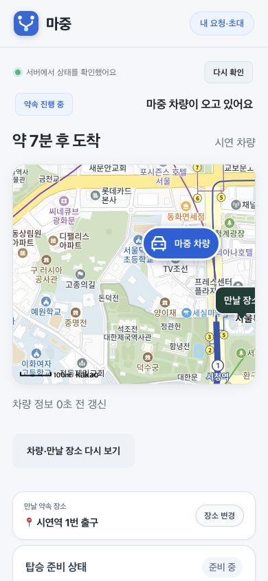
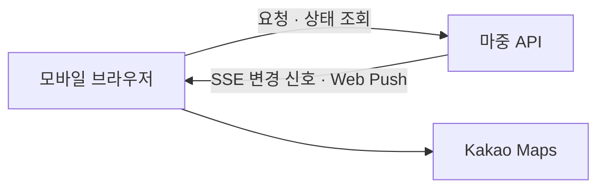

<div align="center">
  
  <h1>마중 웹</h1>
  <p>초대 링크를 열면, 데리러 오는 차량이 언제 도착할지 볼 수 있도록.</p>
  <p><a href="https://majung.cloud/account">마중 요청하기</a> · <a href="https://github.com/majung-team/majung">서비스 소개</a> · <a href="docs/service-screens.md">화면 안내</a> · <a href="https://github.com/majung-team/majung/wiki">기술 회고</a></p>
</div>

## 앱을 설치하지 않아도 참여할 수 있다

운전자가 보낸 초대 링크를 열고 만날 장소를 확인한 뒤 참여한다. 픽업이 시작되면 차량 위치와 도착 시간을 보고, 준비 완료나 ‘지금 내려가요’ 같은 메시지를 보낼 수 있다. 카카오 로그인 후에는 운전자를 찾아 먼저 마중을 요청할 수도 있다.

<div align="center">
  
  <p><sub>11월 6일 게스트 픽업 화면 확인 기록 · 시연 데이터</sub></p>
</div>

| 들어온 경로 | 이어지는 이용 흐름 |
| --- | --- |
| 초대 링크 | 만날 장소 확인 → 게스트 참여 → 내 픽업 시작 후 위치·도착 시간 확인 |
| 로그인 | 사람 검색 → 장소 선택 → 마중 요청 → 차량 수락·차례 대기 → 픽업 진행 |
| 운전자의 차량 QR | 카카오 로그인 → 차량에서 계정 확인 → 연결 완료 |

링크를 열어 장소를 미리 보는 것만으로 참여가 완료되지는 않는다. 대기 중인 탑승자에게 앞선 픽업의 위치를 보여주지 않고, 자신의 픽업이 시작된 뒤에 정보를 제공한다.

## 기다리는 동안 할 수 있는 일

- **준비 상태와 메시지 보내기** — 준비 중·완료를 바꾸고, 빠른 문구 또는 최대 50자 메시지를 전송한다. 서버 저장과 차량 수신 확인을 나눠 표시한다.
- **만날 장소 제안·복사·외부 지도 열기** — 장소·주소 검색이나 지도에서 지점을 고른다. 진행 중인 픽업 카드에서 만날 장소를 복사하거나 카카오맵·네이버 지도로 바로 열 수 있다.
- **최근 장소 빠르게 다시 선택** — 요청한 만날 장소를 최대 5개까지 브라우저에 저장해 다음 마중 요청에서 한 번에 선택하거나 지울 수 있다.
- **도착 알림과 야간 다크 모드** — 지원 브라우저에서 도착 약 3분 전 웹 푸시를 요청할 수 있고, 기기 설정에 따라 시스템 다크 모드를 지원한다.
- **지난 요청 확인하기** — 진행 중인 요청과 지난 기록을 나누고, 지난 기록을 펼친 상태는 갱신 후에도 유지한다.

## 화면이 갱신돼도 하던 입력은 남아야 한다

준비 완료를 저장한 뒤 예전 조회 결과가 늦게 올 수 있다. 이전 응답이 새 상태를 덮지 않도록 하고, 메시지를 쓰는 중에는 화면 갱신이 입력을 방해하지 않게 했다. 장소명과 추가 설명도 따로 관리해, 설명을 수정하다 선택한 장소 이름을 잃지 않도록 한다.

지도 로딩에 실패해도 장소·도착 시간 요약은 따로 남긴다. 차량 정보가 오래되면 지연 상태를 표시하고, 수신이 장시간 끊기거나 픽업이 종료되면 위치·도착 시간을 숨긴다.

[화면 복귀와 상태 동기화 기록](docs/usability-2026-11-05.md) · [위치 정보 유효 시간](docs/vehicle-freshness.md) · [장소 선택·제안](docs/place-proposal.md)

## 로컬 실행

Node.js 22 이상을 사용한다. API 서버는 별도 터미널에서 실행한다. [백엔드 실행 안내](https://github.com/majung-team/majung-backend#먼저-실행해-보기)

```sh
npm ci
npm start
```

- 웹: `http://127.0.0.1:4173/account`
- API: 로컬 서버의 `127.0.0.1:8080`으로 `/api/` 요청 전달
- 포트 변경: `MAJUNG_WEB_PORT`, `MAJUNG_API_PORT` 환경 변수

```sh
npm test
```

화면을 여는 것과 로그인·지도·푸시까지 사용하는 것은 설정이 다르다. 카카오 로그인과 지도 키는 백엔드에서 설정하며, 로컬 로그인은 리다이렉트 URI·쿠키 설정을 맞춰야 한다. 기기 알림은 HTTPS와 지원 브라우저 조건도 확인해야 한다. [계정·차량 연결](docs/account-connections.md) · [도착 알림](docs/arrival-push.md)

## 구성



HTML·CSS·JavaScript ES Modules로 구성하며 UI 프레임워크는 사용하지 않는다. SSE 신호를 받으면 API를 다시 조회하고, 운영에서는 Caddy가 정적 파일과 API를 같은 서비스 주소로 제공한다.

<details>
<summary>기능별 파일 찾기</summary>

| 파일 | 역할 |
| --- | --- |
| `index.html`, `app.js`, `model.js` | 게스트 픽업·상태·도착 시간 계산 |
| `account.html`, `account.js`, `account-api.js` | 로그인·사람 연결·차량 QR·요청 목록 |
| `map.js`, `proposal.js` | 지도·장소 검색·변경 제안 |
| `api.js`, `stream.js` | API 통신·실시간 변경 신호 |
| `push.js`, `sw.js` | 도착 알림·서비스 워커 |
| `test/` | 상태·지도·제안·푸시·SSE·링크 검증 |

</details>

## 확인 범위

[Web CI](https://github.com/majung-team/majung-web/actions)에서 모델·API 연동·응답 순서·화면 복귀 등을 자동 검사한다. 공개 서버를 사용한 기록은 [공통 검증 문서](https://github.com/majung-team/majung/blob/main/docs/rehearsal-2026-11-13.md)에 환경과 함께 남긴다.

실제 휴대전화의 잠금화면·백그라운드 푸시와 LTE/Wi-Fi 전환, 실차의 장시간 위치 연동은 별도 확인 범위다. iOS 앱은 아직 배포 전이며 웹의 ‘앱 열기’에서 현재 이용 조건을 안내한다.

[서비스 화면](docs/service-screens.md) · [개인정보 안내](https://majung.cloud/privacy) · [배포 방법](docs/github-actions.md) · [기여 가이드](CONTRIBUTING.md)
