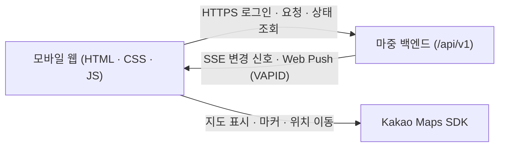

<div align="center">
  
  <h1>마중 웹 (Majung Web)</h1>
  <p>별도 앱 설치 없이 모바일 브라우저에서 카카오 로그인, 지인 연결, 픽업 요청, 초대 참여와 실시간 차량 위치·도착 예정 시간(ETA)을 이용하는 웹 클라이언트입니다.</p>
  <p>
    <a href="https://majung.cloud">모바일 웹</a> ·
    <a href="https://majung.cloud/account">계정 · 마중 요청</a> ·
    <a href="https://github.com/majung-team/majung">마중 프로젝트</a> ·
    <a href="https://github.com/majung-team/majung/wiki">Wiki</a> ·
    <a href="https://github.com/majung-team/majung/blob/main/docs/development-status.md">개발 현황</a>
  </p>
</div>

> 내비게이션 경로나 ETA 계산, 인증·권한 제어는 차량 앱과 백엔드가 담당하며, 웹은 허용된 최신 상태만 화면에 반영합니다.

---

## 1. 주요 기능

### 계정 · 차량 연결 · 마중 요청
- **카카오 로그인 · 지인 연결**: 로그인 후 닉네임과 마중 ID를 설정하고, 지인을 검색해 친구 연결을 관리합니다.
- **차량 QR 연결 · 요청**: 운전자는 차량 QR을 모바일 웹으로 열어 계정을 연결하고, 탑승자는 원하는 장소를 골라 연결 여부와 관계없이 운전자에게 마중을 요청합니다.
- **요청 목록**: 진행 중 요청과 지난 기록을 분리합니다. 지난 기록은 기본으로 접히며 펼친 상태는 새로 확인해도 유지됩니다.
- **만날 장소**: 검색에서 고른 장소명과 추가 설명을 구분해 입력하고 함께 전달합니다. 장소명과 설명을 합한 120자 제한을 적용합니다.

### 초대 링크 참여 · 실시간 픽업
- **초대 링크 게스트 참여**: 회원가입 없이 전달받은 초대 링크로 만날 장소를 먼저 확인한 뒤 참여하거나 대기 중에 나갈 수 있습니다(조회만으로는 링크가 소진되지 않음).
- **차량 배지 · 실시간 지도**: 픽업이 시작되면 매칭된 차량 정보 배지와 현재 위치, 도착 예정 시간(ETA), 도착·완료 상태를 카카오 지도 위에 실시간으로 보여줍니다.

### 소통 · 장소 변경 · 도착 알림
- **준비 상태 · 빠른 메시지**: 준비 상태를 전환하고 빠른 칩이나 직접 입력(최대 50자)으로 메시지를 보내면 차량 화면 알림과 음성(TTS)으로 전달됩니다(입력 중 화면 갱신 간섭 방지·임시 초안 유지).
- **만날 장소 변경 제안**: 픽업 대기·진행 중에 장소명/주소 검색이나 지도에서 새 장소를 제안할 수 있으며, 운전자가 확정하기 전까지는 기존 장소를 유지합니다.
- **도착 임박 웹 푸시**: 브라우저 알림 권한을 허용하면 도착 약 3분 전 웹 푸시 알림을 받을 수 있습니다.

---

## 2. 시스템 구성 및 기술 스택



> SSE는 상태 변경 신호만 전달하며, 웹은 신호를 받거나 재연결될 때 관련 API를 다시 조회해 최신 화면을 맞춥니다.

### 파일 구조

```text
majung-web/
├── index.html / account.html      # 픽업 추적 · 계정/요청 진입 화면
├── privacy.html                   # 개인정보 안내 페이지
├── app.js · api.js · model.js     # 픽업 상태 관리 · 백엔드 API 연동
├── map.js · proposal.js           # Kakao Maps 렌더링 · 장소 검색/변경 제안
├── account.js · account-api.js    # 로그인 · 지인 검색 · 차량 QR 연결 · 마중 요청
├── stream.js · push.js · sw.js    # SSE 실시간 동기화 · Web Push 서비스 워커
├── .well-known/                   # iOS Universal Links 설정 (AASA)
└── test/                          # 모델 · 제안 · 푸시 · SSE · 링크 계약 테스트
```

### 기술 스택

| 구분 | 구성 |
| --- | --- |
| **UI** | Vanilla HTML · CSS · ES Modules JavaScript<br>(별도 프레임워크 미사용) |
| **지도** | Kakao Maps SDK · Server-Sent Events(SSE)<br>Service Worker · Web Push(VAPID) |
| **운영** | Caddy(HTTPS · 정적 서빙) · GitHub Actions<br>Node.js 22+ `node --test` |

---

## 3. 보안 정책 및 검증 범위

- **정보 신선도 구분 · 노출 제한**: 차량 좌표는 수신 시점에 따라 최신(`FRESH`)·지연(`STALE`)·대기(`WAITING`) 상태로 구분해 오래된 좌표를 현재 위치처럼 보이지 않으며, 대기 중인 탑승자에게는 다른 픽업의 위치·ETA나 차량 전용 인증 토큰을 전달하지 않습니다.
- **비밀 값 분리**: 로그인 쿠키, CSRF 토큰, 초대 토큰 원문, 카카오 인증 키는 저장소에 포함하지 않고 백엔드 서버에서 안전하게 관리합니다.

| 구분 | 범위 |
| --- | --- |
| **확인&nbsp;완료** | `node --test` (`104 passed`) · 공개 `majung.cloud`<br>iPhone·데스크톱 초대 재시도·장소 제안·지도 복구 |
| **추후&nbsp;확인** | 백그라운드/잠금화면 Web Push · LTE/Wi-Fi 전환<br>실차 주행 중 장시간 위치·ETA 연동 |

---

## 4. 상세 문서 및 관련 저장소

| 분류 | 문서 |
| --- | --- |
| **화면&nbsp;·&nbsp;기능** | [서비스 화면](docs/service-screens.md) · [탑승자 지도](docs/passenger-map.md) · [장소 선택 및 제안](docs/place-proposal.md)<br>[사람 찾기 및 계정](docs/account-connections.md) · [초대 자동 참여](docs/auto-connect.md) |
| **정책&nbsp;·&nbsp;운영** | [차량 정보 최신성](docs/vehicle-freshness.md) · [도착 임박 알림](docs/arrival-push.md)<br>[GitHub Actions 배포](docs/github-actions.md) · [기여 가이드](CONTRIBUTING.md) |
| **허브&nbsp;·&nbsp;회고** | [전체 아키텍처](https://github.com/majung-team/majung/blob/main/docs/architecture.md) · [개발 현황](https://github.com/majung-team/majung/blob/main/docs/development-status.md)<br>[Wiki 기술 회고](https://github.com/majung-team/majung/wiki#%EA%B8%B0%EC%88%A0-%ED%9A%8C%EA%B3%A0) |

| 저장소 | 역할 |
| --- | --- |
| [majung](https://github.com/majung-team/majung) | 전체 서비스 소개 · 설계 · 시연 |
| [majung-vehicle-app](https://github.com/majung-team/majung-vehicle-app) | AAOS 차량 앱 및 Pleos SDK 연동 |
| [majung-web](https://github.com/majung-team/majung-web) | 운전자 · 탑승자 모바일 웹 |
| [majung-ios](https://github.com/majung-team/majung-ios) | SwiftUI iOS 모바일 앱 |
| [majung-backend](https://github.com/majung-team/majung-backend) | Spring Boot API 및 운영 배포 |
