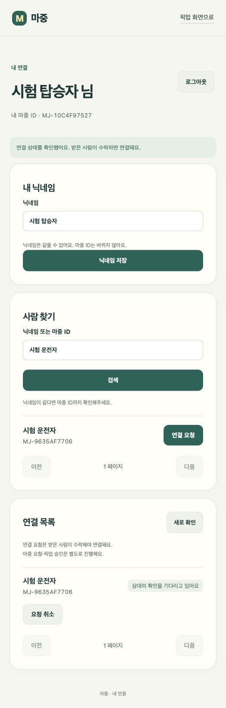
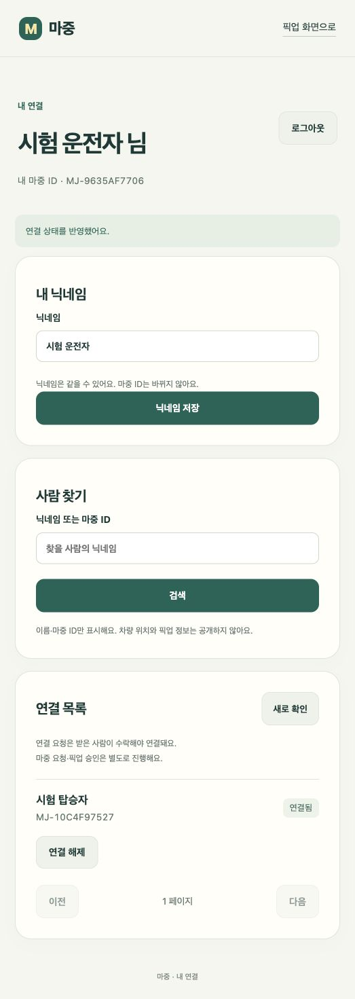
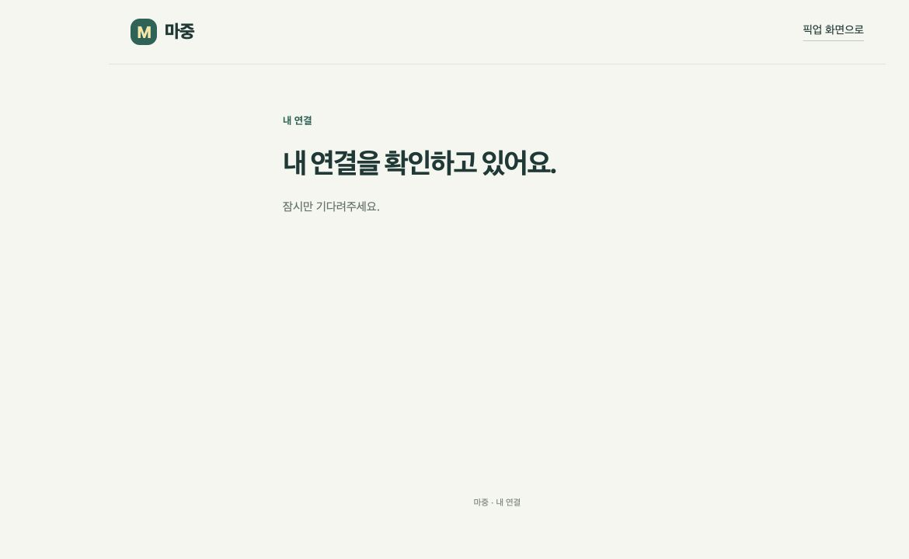
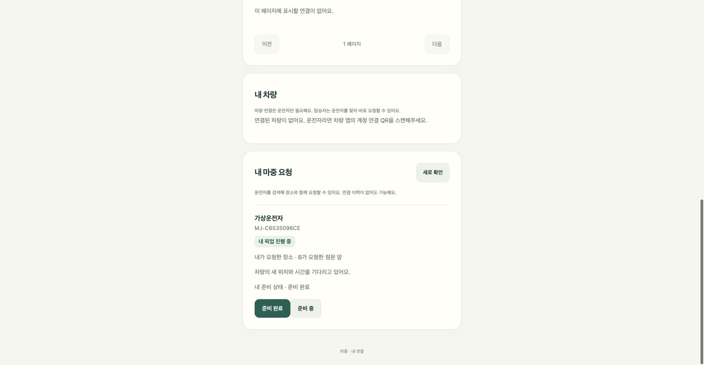
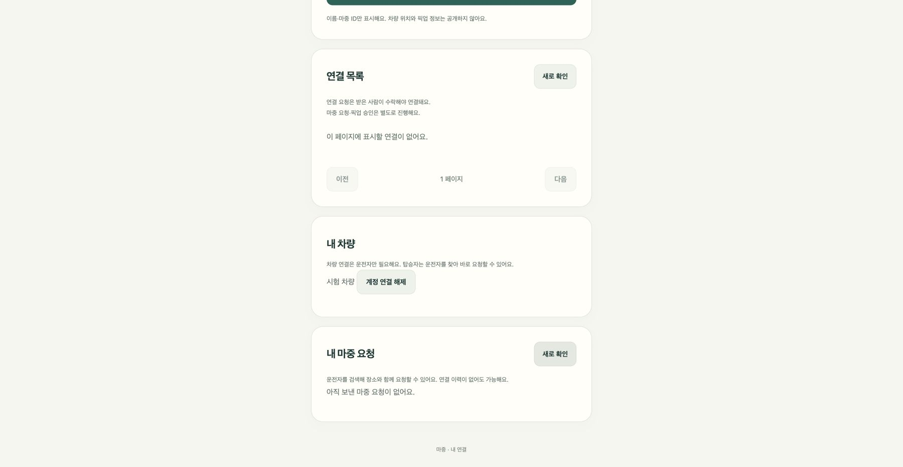

# 계정 화면 — 로그인·사람 연결·마중 요청

마중 모바일 웹의 계정 화면은 카카오 로그인, 닉네임 관리, 사람 검색, 연결 요청 및 마중 요청 기능을 제공한다.

운전자는 자신의 차량을 계정에 연결할 수 있고, 탑승자는 기존 사람 연결 없이도 운전자를 검색하여 픽업을 요청할 수 있다.

이 문서는 계정 화면의 사용 흐름, 인증 처리, 차량 연결, 오류 대응 및 검증 결과를 설명한다.

> 공개 계정 주소는 `https://majung.cloud/account`다. 초기 사람 연결 기능의 검증 기록은 2026년 10월 25일 기준이며, 이후 추가된 마중 요청·차량 QR 연결·장소 선택 기능은 별도로 구분한다.

---

## 1. 계정 화면의 주요 기능

| 기능 | 설명 |
| --- | --- |
| 카카오 로그인 | 마중 계정 로그인 |
| 닉네임 관리 | 닉네임 최초 설정 및 변경 |
| 마중 ID | 본인의 고유 계정 ID 확인 |
| 사람 찾기 | 닉네임 또는 마중 ID 검색 |
| 사람 연결 | 연결 요청·수락·거절·취소·해제 |
| 마중 요청 | 운전자에게 장소와 함께 픽업 요청 |
| 픽업 상태 | 응답 대기·대기 순서·진행 중 픽업 확인 |
| 차량 계정 연결 | 운전자 계정과 차량 연결·해제 |

사람 연결과 마중 요청은 서로 다른 기능이다.

사람 연결은 두 계정 사이의 관계를 관리하며, 마중 요청은 특정 장소로 픽업을 요청하는 기능이다.

---

## 2. 카카오 로그인

계정 기능을 이용하려면 카카오 로그인이 필요하다.

### 로그인 흐름

1. `/account` 접속
2. 카카오 로그인 선택
3. 카카오 인증 및 동의
4. 마중 계정 확인 또는 생성
5. 필요한 경우 닉네임 설정
6. 계정 화면 표시

로그인에 필요한 카카오 인증정보는 백엔드에서 처리한다.

웹은 카카오 액세스 토큰을 직접 보관하지 않는다.

### 인증 방식

| 항목 | 처리 |
| --- | --- |
| 로그인 | Spring Security OAuth2 |
| 브라우저 인증 | HttpOnly 서버 세션 쿠키 |
| 상태 변경 보호 | CSRF 토큰 |
| CSRF 토큰 저장 | 페이지 메모리 |
| 카카오 비밀 키 | 서버에서만 관리 |

웹에서 변경 요청을 보낼 때는 서버가 제공한 CSRF 토큰을 사용한다.

차량 장치의 Bearer 토큰이나 픽업 접근 토큰을 계정 로그인 세션으로 대신 사용하지 않는다.

---

## 3. 닉네임과 마중 ID

### 닉네임 설정

최초 로그인 후 마중에서 사용할 닉네임을 설정한다.

닉네임은 다른 사용자와 중복될 수 있다.

### 마중 ID

각 계정에는 고유한 마중 ID가 부여된다.

같은 닉네임을 사용하는 계정이 있더라도 마중 ID를 이용해 구분할 수 있다.

### 닉네임 변경

닉네임을 변경해도 다음 정보는 유지된다.

- 기존 마중 ID
- 계정 식별 정보
- 기존 사람 연결 관계

사람 연결은 닉네임 문자열이 아니라 계정 식별자를 기준으로 관리한다.

---

## 4. 사람 찾기

사용자는 닉네임 또는 정확한 마중 ID로 다른 계정을 검색할 수 있다.

### 검색 흐름

1. `사람 찾기` 화면 열기
2. 닉네임 또는 마중 ID 입력
3. 검색 결과 확인
4. 같은 닉네임이 있다면 마중 ID 비교
5. 상대 계정 선택
6. 사람 연결 또는 마중 요청 선택

검색된 계정이 현재 픽업 중이거나 차량을 보유하고 있다는 뜻은 아니다.

### 두 가지 요청

| 기능 | 목적 | 결과 |
| --- | --- | --- |
| 연결만 요청 | 사용자 사이의 관계 생성 | 상대 수락 후 연결됨 |
| 마중 요청 | 장소를 지정해 운전자에게 픽업 요청 | 운전자 수락 후 대기열 진입 |

**사람 연결을 먼저 완료해야 마중 요청을 보낼 수 있는 것은 아니다.**

---

## 5. 사람 연결 요청

사람 연결은 상대방의 명시적인 수락으로 완료된다.

### 요청 보내기

1. 사람 검색
2. 연결할 계정 선택
3. `연결 요청` 선택
4. 상대방의 응답 대기

요청을 보낸 계정에는 확인 대기 상태를 표시한다.

### 받은 요청 처리

상대방은 `받은 연결 요청`에서 요청을 수락하거나 거절할 수 있다.

수락하면 양쪽 연결 목록에 `연결됨`으로 표시된다.

### 요청 취소 및 연결 해제

- 보낸 대기 요청: 취소 가능
- 받은 대기 요청: 수락·거절 가능
- 승인된 연결: 확인 화면을 거쳐 해제 가능

### 픽업과의 관계

사람 연결을 승인해도 다음 동작은 발생하지 않는다.

- 픽업 자동 생성
- 차량 위치 자동 공개
- ETA 조회 권한 자동 부여
- 차량 계정 연결

사람 연결과 픽업 접근 권한은 별도로 관리한다.

---

## 6. 탑승자 마중 요청

차량에 연결한 적 없는 탑승자도 운전자를 검색해 마중 요청을 보낼 수 있다.

탑승자에게 차량 QR이나 차량 장치 권한을 요구하지 않는다.

### 요청 흐름

1. 카카오 로그인
2. 닉네임 설정
3. 운전자 검색
4. `마중 요청` 선택
5. 만날 장소 선택
6. 장소 설명 입력
7. 요청 전송
8. 운전자 응답 확인

### 장소 선택

현재 웹은 다음 방식으로 장소를 선택할 수 있다.

- 현재 위치
- 지도 핀
- 장소명 검색
- 주소 검색

초기 구현에서는 현재 위치 선택부터 지원했으며, 지도 핀과 장소명·주소 검색은 이후 추가됐다.

[웹 장소 선택](pickup-place-selection.md)

### 현재 위치

브라우저의 위치 권한을 이용해 현재 위치를 선택한다.

위치 오차가 300m를 초과하면 다시 선택하도록 안내한다.

좌표를 URL이나 공개 로그에 포함하지 않는다.

### 운전자 수락

운전자는 차량 앱에서 요청자를 확인하고 마중 요청을 수락한다.

수락하면 대기 순서가 부여된다.

이 승인은 해당 픽업 요청에 대한 동의이며, 기존 사람 연결 목록을 자동으로 변경하지 않는다.

---

## 7. 마중 요청 상태 표시

| 상태 | 화면 표시 |
| --- | --- |
| 응답 대기 | 운전자 응답을 기다리는 중 |
| 수락·대기 | 내 앞의 요청 수 |
| 픽업 진행 | 내 픽업의 ETA 및 준비 상태 |
| 종료 | 완료·취소·거절·만료 결과 |

### 응답 대기

운전자가 응답하기 전까지 최대 30분 동안 대기한다.

### 픽업 대기

요청이 수락되면 대기열에 추가된다.

운전자별 열린 요청은 최대 50건이며, 수락된 요청의 대기 시간은 최대 2시간이다.

### 진행 중인 픽업

자기 차례가 시작되면 본인의 픽업 정보를 표시한다.

- 만날 장소
- 차량 정보
- ETA
- 준비 상태

대기 중에 표시하는 현재 진행 중인 픽업의 남은 시간은 **내 장소까지의 도착 예정 시간이 아니다.**

다른 탑승자의 이름이나 장소도 표시하지 않는다.

---

## 8. 차량 계정 연결

운전자는 차량에 표시된 QR을 휴대전화로 열어 자신의 마중 계정을 차량에 연결한다.

### 일반적인 연결 흐름

1. 차량 QR 표시
2. 휴대전화로 QR 열기
3. 카카오 로그인
4. 닉네임 설정
5. 휴대전화에서 연결 요청
6. 차량 화면에서 닉네임·마중 ID 확인
7. 운전자가 차량에서 승인
8. 연결 완료 표시

휴대전화에서 요청을 보냈다는 이유만으로 차량이 연결된 것으로 표시하지 않는다.

### 최초 차량 연결과 기존 차량 연결

| 구분 | URL fragment |
| --- | --- |
| 최초 차량 등록·계정 연결 | `#enroll/…` |
| 이미 등록된 차량의 계정 연결 | `#vehicle/…` |

일반 사용자에게 관리자 등록 코드 입력을 요구하지 않는다.

### QR 보안

차량 연결 QR의 유효 시간은 5분이다.

웹은 QR 정보를 읽은 뒤 URL fragment를 제거한다.

카카오 로그인 왕복 동안 필요한 연결 정보는 같은 탭의 `sessionStorage`에 임시 보관한다.

차량의 장치 비밀은 웹에 전달하거나 저장하지 않는다.

### 차량 최종 승인

차량에서 계정을 승인하기 전까지는 연결 대기 상태를 표시한다.

승인이 완료된 뒤에만 내 차량 연결 상태를 갱신한다.

---

## 9. 로그인 및 API 오류 처리

계정 화면은 서버 응답 상태에 따라 안내 화면을 구분한다.

### 첫 세션 조회

| 상태 | 화면 처리 |
| --- | --- |
| 첫 조회 진행 중 | 조회 중 안내 |
| 조회 성공 | 로그인 또는 계정 화면 |
| 조회 실패 | 오류 안내 및 다시 확인 버튼 |
| 로그인 기능 비활성화 | 로그인 준비 안내 |

첫 세션 응답이 도착하지 않았는데 로그인 상태를 임의로 확정하지 않는다.

### 세션 만료

로그인 세션이 만료되면 다시 로그인하도록 안내한다.

### CSRF 검증 실패

CSRF 검증에 실패하면 세션 정보를 새로 조회한다.

하지만 실패한 상태 변경 요청을 자동으로 다시 전송하지 않는다.

### 통신 오류

연결 요청이나 취소 요청 중 통신 오류가 발생하면 서버에서 실제 처리됐는지 불확실할 수 있다.

이 경우 관련 목록을 다시 조회하여 현재 상태를 확인한다.

자동 재전송으로 중복 요청을 생성하지 않는다.

### 오류 정보 보호

다음 정보는 화면에 그대로 표시하지 않는다.

- 카카오 인증 공급자의 비밀 값
- 내부 프록시 오류 HTML
- 인증 관련 민감한 응답
- 사용자 세션 및 접근 토큰

---

## 10. 계정 화면 URL

공개 계정 주소는 다음과 같다.

```text id="a0b6lb"
https://majung.cloud/account
```

`account.html`은 내부 구현 파일명이다.

다음 기존 주소는 `/account`로 이동한다.

```text id="5hcifz"
/account.html
/account/
```

이동 시 기존 쿼리 문자열을 유지한다.

### URL 처리 기준

| 요청 | 처리 |
| --- | --- |
| `/account` | 계정 화면 |
| `/account.html` | `/account`로 이동 |
| `/account/` | `/account`로 이동 |
| 알 수 없는 경로 | HTTP 404 |

알 수 없는 주소를 무조건 계정 화면으로 처리하지 않는다.

로컬 개발 서버와 운영 Caddy에서 같은 URL 규칙을 사용한다.

---

## 11. 프론트엔드 파일 구성

| 파일 | 역할 |
| --- | --- |
| `account.html` | 계정 화면 HTML |
| `account.css` | 화면 스타일 |
| `account.js` | 닉네임·검색·연결·사용자 입력 |
| `account-api.js` | 세션·CSRF·API 요청 및 오류 처리 |
| `account-api.test.js` | 인증 요청 및 오류 처리 테스트 |

### account.js

계정 화면의 상태와 사용자 입력을 처리한다.

주요 역할:

- 로그인 상태 표시
- 닉네임 설정 및 변경
- 사람 검색 결과 표시
- 연결 요청 목록
- 연결 상태 변경
- 마중 요청 화면 연동
- 차량 계정 연결 화면 연동

### account-api.js

동일한 HTTPS origin의 백엔드 API를 사용한다.

주요 처리:

- 세션 조회
- CSRF 토큰 관리
- 요청 시간 제한
- 오류 응답 처리
- 결과가 불확실한 요청의 자동 재전송 방지

---

## 12. 최초 계정 기능 테스트

**검증일: 2026년 10월 25일**

### 자동 테스트

```sh id="aywu9x"
npm test
```

| 항목 | 결과 |
| --- | --- |
| 기존 초대·위치 표시 테스트 | 6건 통과 |
| 계정 클라이언트 테스트 | 3건 통과 |
| 전체 | 9건 통과 |

이 수치는 최초 계정 기능 통합 당시의 결과다.

이후 추가된 테스트 전체의 현재 건수를 의미하지 않는다.

### 로컬 브라우저 통합 시험

다음 환경을 사용했다.

- 로컬 HTTP OAuth2 공급자
- 실제 Spring Security
- 실제 Tomcat
- H2 데이터베이스
- 브라우저
- 가상 계정 2개

### 확인 결과

- 두 계정 로그인
- 닉네임 설정
- 사용자 검색
- 연결 요청
- 요청 수락
- 연결 해제
- 보낸 요청의 대기 표시
- 받은 요청의 수락·거절 버튼
- 승인 후 연결 상태 표시

### 시험 화면





위 화면의 계정·닉네임·마중 ID는 모두 로컬 시험용 가상 데이터다.

---

## 13. 계정 로딩 및 오류 화면 테스트

서버 응답을 지연시키거나 오류를 반환하도록 설정하여 화면 상태를 확인했다.

### 시험 조건

- 세션 응답 지연
- HTTP 503
- 서버 정상 복구

### 확인 결과

- 조회 중 안내 표시
- 오류 메시지 및 재시도 버튼
- 정상 복구 후 로그인 버튼 표시
- 응답 상태에 따른 화면 전환



이 화면은 로컬 서버의 세션 응답을 의도적으로 지연시켜 확인한 결과다.

실제 운영 장애 상황에서 측정한 응답 시간이나 복구 시간은 아니다.

---

## 14. 공개 HTTPS 로그인 검증

**검증일: 2026년 10월 25일**

운영 서버에서 실제 카카오 로그인과 계정 화면 진입을 확인했다.

### 확인 항목

- 실제 카카오 로그인
- 닉네임 저장
- 새로고침 후 세션 유지
- 로그아웃
- 재로그인
- 기존 마중 ID 유지
- 로그인 성공 후 `/account` 이동

### 당시 미검증 항목

- 실제 카카오 계정 두 개 사이의 연결 요청·수락
- 실제 휴대전화 브라우저
- 실차 환경

운영 HTTPS 로그인 성공과 실제 두 사용자 사이 연결 검증은 별개다.

---

## 15. 공개 URL 및 Caddy 검증

**검증일: 2026년 10월 25일**

마중 운영 서버에서 Caddy 설정을 검증하고 reload했다.

### 확인 결과

| 대상 | 결과 |
| --- | --- |
| `/account` | HTTP 200 |
| `/account.html` | HTTP 308 |
| `/account/` | HTTP 308 |
| 로그인 실패 쿼리 | 이동 후 유지 |
| 계정 CSS | HTTP 200 |
| 알 수 없는 경로 | HTTP 404 |
| 외부 관리자 경로 | HTTP 404 |
| API health | HTTP 200 |

정적 웹 파일 교체와 Caddy 설정 변경은 별도의 작업이다.

새로운 운영 환경을 구성할 때도 동일한 URL 이동 규칙을 유지해야 한다.

---

## 16. 신규 탑승자 마중 요청 구현

**초기 기록: 2026년 10월 25일 작업 브랜치**

사람 연결 이력이 없는 탑승자도 운전자에게 장소와 함께 마중 요청을 보낼 수 있도록 기능을 확장했다.

### 초기 구현 범위

- 운전자 검색
- 현재 위치 선택
- 장소 설명 입력
- 마중 요청 전송
- 운전자 응답 대기
- 수락 후 대기 순서 표시
- 자기 차례의 픽업 정보 확인
- 준비 상태 변경

당시에는 지도 검색·장소 선택과 앱이 닫힌 상태의 요청 알림이 포함되지 않았다.

이후 지도 핀과 장소명·주소 검색 기능이 추가됐으므로 당시의 미구현 기록을 현재 상태로 해석하지 않는다.

### 시험 결과

웹 자동 테스트 10건을 통과했다.

실제 로컬 서버와 브라우저에서 다음 흐름을 확인했다.

1. 가상 탑승자 B 로그인
2. 운전자 검색
3. 가상 현재 위치 선택
4. 마중 요청 전송
5. 운전자 응답 대기
6. 차량 권한 API로 요청 수락
7. 자기 픽업 시작
8. 준비 완료 상태 확인

대기 중에는 다른 탑승자의 이름과 장소가 표시되지 않았다.

차량 위치 정보는 유효 시간이 지나면 화면에서 제거되는 것도 확인했다.

### 시험 화면



위 화면은 로컬 가상 계정과 시험 좌표를 사용했다.

실제 휴대전화 GPS나 실차 위치 데이터가 아니다.

### 당시 배포 상태

이 검증은 PR 검토 전 작업 브랜치에서 진행했다.

운영 서비스 배포 완료와 구분한다.

당시 마중 전용 DB에는 백업 후 관련 신규 테이블 3개와 앱 계정 권한을 준비했다.

기존 애플리케이션은 재시작하지 않았으며, 새 웹 API 사용을 위해 서버 기능 반영이 선행되어야 했다.

---

## 17. 차량 계정 연결 로컬 검증

계정 연결 QR을 이용해 로그인 후 차량 연결 요청을 이어가는 흐름을 확인했다.

### 시험 흐름

1. 차량에서 계정 연결 QR 생성
2. 휴대전화 계정 페이지로 이동
3. 카카오 로그인 복귀
4. 임시 연결 요청 복원
5. 휴대전화에서 연결 요청 전송
6. 차량 승인 전 미연결 상태 확인
7. 차량 권한 API에서 최종 승인
8. 차량 연결 완료 표시

### 확인 결과

- 로그인 복귀 후 연결 요청 정보 유지
- 휴대전화 요청만으로 차량 목록 변경되지 않음
- 차량 승인 후 연결 완료
- QR의 임시 정보 처리



해당 검증은 로컬 서버와 가상 계정을 사용했다.

실제 카카오 계정·휴대전화·실차에서의 연결 완료를 의미하지 않는다.

---

## 18. 현재 기능과 검증 범위

### 구현된 계정 화면 기능

- 카카오 로그인 및 닉네임 관리
- 사람 검색 및 연결
- 마중 요청
- 요청 대기열 확인
- 자기 픽업 상태 및 ETA 표시
- 현재 위치·지도 핀·장소명·주소 선택
- 차량 QR 계정 연결
- 연결 상태 및 오류 안내

### 별도 검증이 필요한 항목

- 실제 두 카카오 계정 사이 연결 흐름
- 실제 휴대전화 GPS 정확도
- 실제 모바일 브라우저의 차량 QR 연결
- LTE·Wi-Fi 전환 중 요청 상태 복구
- 백그라운드 알림
- 실차와 연결한 전체 마중 요청

로컬 가상 계정과 브라우저에서 확인한 결과를 실제 휴대전화 또는 실차 검증 완료로 표현하지 않는다.

---

## 19. 관련 문서

- [웹 README](../README.md)
- [웹 화면 사용 흐름](service-screens.md)
- [탑승자 지도](passenger-map.md)
- [웹 장소 선택](pickup-place-selection.md)
- [초대 링크 자동 참여](auto-connect.md)
- [차량 정보 최신성](vehicle-freshness.md)
- [장소 제안](place-proposal.md)
- [백엔드 카카오 로그인·사람 연결](https://github.com/majung-team/majung-backend/blob/main/docs/account-connections.md)
- [백엔드 픽업 요청 및 대기열](https://github.com/majung-team/majung-backend/blob/main/docs/ride-requests.md)
- [백엔드 차량 계정 연결](https://github.com/majung-team/majung-backend/blob/main/docs/vehicle-account-link.md)
- [개발 현황 및 검증 기록](https://github.com/majung-team/majung/blob/main/docs/development-status.md)

---

## 문서 관리 기준

이 문서는 마중 모바일 웹의 계정 화면, 사람 연결, 픽업 요청 및 차량 연결 흐름을 설명한다.

다음 항목을 구분하여 기록한다.

- 사람 연결과 마중 요청
- 계정 로그인 세션과 차량 장치 권한
- 운전자 요청 수락과 실제 픽업 시작
- 최초 구현과 이후 추가 기능
- 로컬 가상 계정과 실제 카카오 계정 시험
- main 반영과 운영 배포
- 브라우저 시험과 실제 휴대전화·실차 검증

기능 변경 시 실제 구현·시험·배포 시점을 함께 기록한다.
