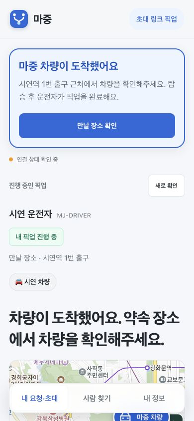
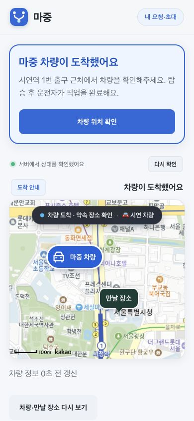

# 픽업 상태 안내와 입력 보존 점검 · 2026-11-05

## 바꾼 내용

| 문제 | 반영 내용 |
| --- | --- |
| 입력 중 상태 갱신 누락 | 조회는 계속하고 도착 배너·ETA·지도만 갱신. 취소·완료·권한 해제는 이전 위치 화면 제거 |
| 도착 안내가 약함 | 초대/로그인 화면에 같은 상단 도착 배너와 만날 장소 확인 버튼. 입력 중 강제 스크롤 제거 |
| 메시지 100자/50자 불일치 | 최대 50자와 글자 수 표시, 51자 전송 차단 |
| 실패 때 초안 삭제 | 두 진입 경로 모두 초안 보존. 저장 성공 뒤에만 비움 |
| 차량 수신 오인 | 서버 저장과 차량 수신을 구분. 운전자가 읽었다고 표시하지 않음 |
| 오래된 ETA | 마지막 예상 시간·갱신 지연 표시. 유효 기간이 지나면 시간과 차량 마커 숨김 |
| 지도 실패 때 제안도 숨김 | 장소명·미확정 설명·제안 취소 유지. 지도 선택만 제한 |
| 알림 클릭 목적지 | 알림 종류와 공개 ID를 암호화해 해당 픽업으로 연결. 새 탭의 참여 권한은 자동 생성하지 않음 |
| 다른 메뉴의 초대 | 상단 안내와 메뉴 개수 표시 |
| 대기 ETA 혼동 | 내 앞 순서·내 ETA 미정과 앞선 픽업 참고 시간을 별도 영역으로 구분 |
| 지도에서 차량 찾기 | 차량·만날 장소를 다시 보여주는 버튼. 자동 갱신 때 사용자가 움직인 지도는 유지 |

차량의 도착·완료 고정 버튼과 다음 대기자 표시는 [차량 앱 작업](https://github.com/majung-team/majung-vehicle-app/issues/118)에서 함께 반영한다.

## 확인한 방법

`npm test` 87개 통과. 실제 app.js/account.js를 실행하는 회귀 시험에서 입력 중 도착 갱신·취소 화면 제거·메시지 실패 초안 보존을 확인했다. 지도 재이동, 지도 실패 시 제안 유지, 서비스 워커의 알림 종류·경로·오래된 이벤트·외부 URL 제한도 포함한다.

로컬 예시 API를 Chrome에 연결해 로그인/초대 참여 도착 화면과 390×844 모바일 화면을 확인했다. 메시지에 포커스를 둔 채 서버 예시 상태를 ARRIVED로 바꿨을 때 초안과 포커스가 유지되고 상단 배너가 바뀌었다. 화면 자료는 예시 상태이며 실제 사용자 위치·로그인 정보가 아니다.

실제 휴대전화의 새 도착 푸시 수신과 실차 시험은 이 결과에 포함하지 않는다. 알림이 브라우저에 표시됐는지 서버만으로는 알 수 없다.
