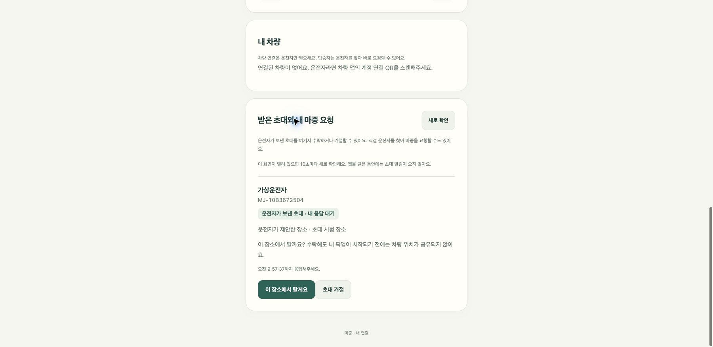
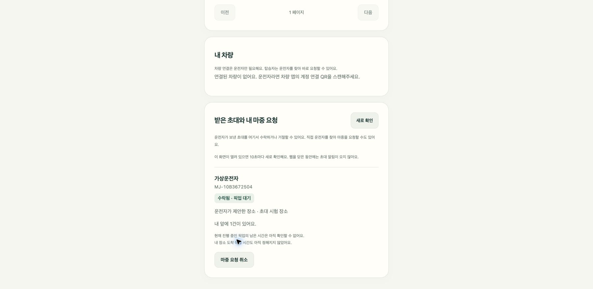

# 차량에서 받은 초대

차량에 연결된 운전자가 내 연결 목록에서 탑승자를 골라 초대를 보낸다.
탑승자는 `https://majung.cloud/account`에 로그인해서 ‘받은 초대와 내 마중 요청’을 확인한다.

- ‘운전자가 보낸 초대 · 내 응답 대기’와 만날 장소를 확인한다.
- ‘이 장소에서 탈게요’를 누르면 픽업 대기에 들어간다. 원하지 않으면 ‘초대 거절’을 누른다.
- 수락해도 내 픽업이 시작되기 전에는 차량 위치를 볼 수 없다.
- 앞에 진행 중인 픽업이 있다면 대기 건수와 현재 픽업의 남은 시간만 표시한다. 이 시간은 내 장소의 도착 예정 시간이 아니다.

응답하지 않은 초대는 30분 뒤 만료된다. 운전자가 취소하거나 사람 연결이 해제된 초대도 수락할 수 없다.
웹을 열어두면 10초마다 새로 확인한다. 웹을 닫아둔 동안의 푸시 알림은 아직 지원하지 않는다.

## 로컬 확인

서버의 `MAJUNG_BROWSER_FIXTURE=true MAJUNG_INVITATION_FIXTURE=true` 가상 로그인 시험과 웹 프록시를 함께 실행한다.
가상 사용자 3으로 로그인하면 초대를 받은 탑승자를 확인할 수 있다. 실제 카카오 계정이나 공용 서버를 사용하지 않는다.
이번 확인에서는 웹에서 초대를 수락한 뒤 앞선 픽업 1건 뒤에 대기하는 것까지 확인했다. 브라우저 콘솔 오류는 없었다.

