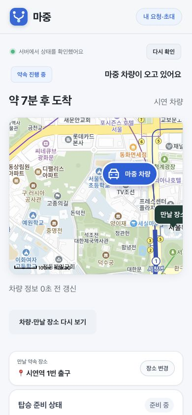

# 도착 시간과 전송 안내

도착 시간은 지도 안의 작은 캡슐에서 지도 위 요약으로 옮겼다. 지도 실패나 지도 내부 요소와 관계없이 예상 시간을 확인할 수 있다. 시간은 기존 최신성 기준을 그대로 쓰며 차량 정보가 없을 때 임의로 만들지 않는다.

메시지 성공 문구는 ‘메시지를 보냈어요’로 줄였다. 준비 상태는 ‘준비 상태를 보냈어요 → 차량 연결을 기다리고 있어요 → 차량에 전달됐어요’로 표시한다. 마지막 단계는 기존 차량 수신 순번 확인을 통과했을 때만 사용하며 읽음 표시는 하지 않는다.

Node 시험 89개 통과. Chrome 390×844의 시험 데이터 화면에서 ‘약 7분 후 도착’과 가로 넘침이 없는 것을 확인했다. 실제 차량의 교통 변화나 실기기 알림 수신 시험은 아니다.

