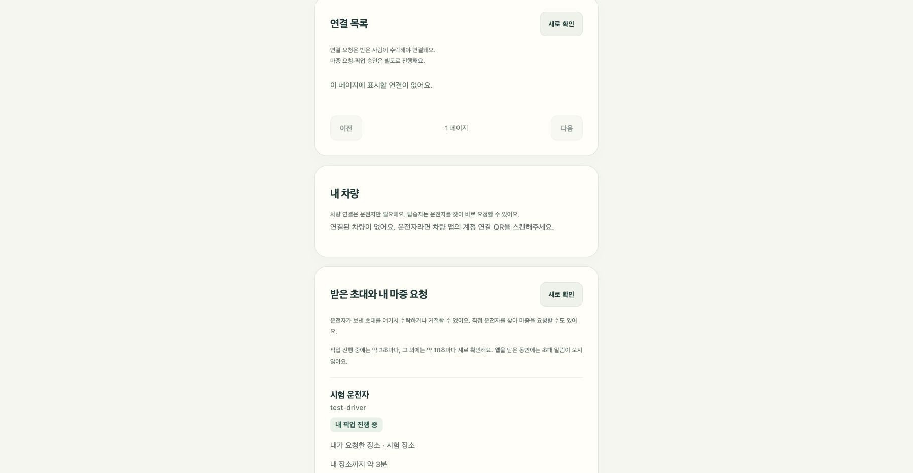

# 남은 시간 갱신과 SSE 검토

## 지금 적용한 동작

차량 앱은 약 5초마다 내비 SDK 위치·목적지 ETA를 조회한다. 서버 전송도 정상 정보 기준 최소 5초 간격이다. SDK 콜백과 네트워크 응답에 걸리는 시간이 더해지므로 초 단위 전달을 보장하지 않는다.

초대 링크 화면은 3초마다 서버를 확인한다. 이 변경에서는 계정 화면도 진행 중인 픽업이 있으면 응답 완료 후 약 3초마다 확인하도록 맞췄다. 그 외에는 10초 간격을 유지한다. 숨긴 탭·입력 중에는 멈추고, 다시 열린 탭은 다음 검사에서 새로 확인한다. 쓰기 요청은 자동 재전송하지 않는다.

화면의 1초 카운트다운은 마지막 ETA에서 경과 시간을 빼는 표시다. 교통 상황을 매초 다시 계산하는 기능이 아니다. SDK가 7분 대신 12분을 알려주면 새 12분으로 바뀐다. 새 값이 더 작아도 같은 방식으로 반영한다. 계정 조회가 실패하면 이전 위치와 카운트다운을 숨기고, 연결이 복구되면 새 응답을 표시한다.

실제 정체·우회 시 SDK의 ETA 재계산은 실차에서 아직 확인하지 않았다. 서버 전달 방식만 바꾼다고 SDK의 교통 정보가 더 정확해지지는 않는다.

## 시험

- 자동 시험: 새 ETA 증가·감소, 통신 실패 시 숨김과 복구, 세션 종료 시 숨김, 탭 복귀 후 조회 확인.
- 실제 account.js를 격리된 DOM·API·시계에서 실행해 3초 조회 동작과 실패 후 표시 제거 확인. SDK·교통 상황 재현 시험과는 다르다.
- 로컬 브라우저의 가상 계정으로 7분 → 12분 응답 변경과 화면 반영 확인. 운영 계정·실제 위치는 사용하지 않는다.

캡처는 로컬 시험 계정과 시험 응답이다.

## SSE 적용 방향 — 설계안

SSE는 서버에서 화면으로 변경을 전달하는 데 맞는다. 준비 상태 입력·픽업 수락 같은 쓰기는 기존 HTTP API로 유지한다. 현재 한 대의 서버에서는 별도 Kafka 없이 검토할 수 있다.

처음 적용할 때는 위치 전체를 이벤트에 싣기보다 ‘상태 변경’ 신호만 보내고, 웹이 기존 인증된 API로 최신 상태를 다시 읽는 방식을 우선 검토한다. 중간 이벤트를 놓쳐도 재연결 후 현재 상태로 맞출 수 있고, 종료된 접근 권한도 기존 조회에서 검사할 수 있다.

| 항목 | 구현 전에 지킬 조건 |
| --- | --- |
| 계정 화면 | 같은 출처의 HttpOnly 로그인 쿠키 사용. 로그아웃·세션 만료 시 스트림 종료 |
| 초대 탑승자 | 기존 Bearer 인증 유지. 기본 EventSource에는 사용자 지정 Authorization 헤더 설정이 없으므로 fetch 스트림 등을 검토. 토큰을 URL에 넣지 않음 |
| 범위 | 본인의 현재 픽업·요청 목록만 구독. 다른 사람의 픽업 위치·이름·대기 장소를 보내지 않음 |
| 발행 | DB 커밋 후 신호 전송. 실패한 쓰기를 완료 이벤트로 보내지 않음 |
| 종료 | 탑승자 끊기·초대 재발급·픽업 종료·계정 해제 시 권한 재검사 후 연결 정리 |
| 재연결 | 제한된 재시도·heartbeat·현재 상태 재조회. 중복 신호는 합치고 쓰기를 재실행하지 않음 |
| 장애 | 스트림 실패 시 기존 조회로 복귀. 새 정보가 없으면 오래된 정보 표시 정책 유지 |
| 자원 | 계정·픽업별 연결 수 제한, 느린 클라이언트 정리, Caddy 경유 지연 측정 |

SSE는 웹이 닫힌 동안의 도착 알림을 대체하지 않는다. 그 용도로는 서비스 워커의 웹 푸시를 사용한다. SSE 전환 여부는 변경 발생부터 화면 반영까지 걸린 시간과 동시 접속 시 자원을 측정한 뒤 결정한다. 이 PR에는 SSE 서버·웹 스트림 코드를 추가하지 않았다.

참고: [MDN SSE 가이드](https://developer.mozilla.org/en-US/docs/Web/API/Server-sent_events/Using_server-sent_events), [Spring MVC 비동기 응답](https://docs.spring.io/spring-framework/reference/web/webmvc/mvc-ann-async.html)
