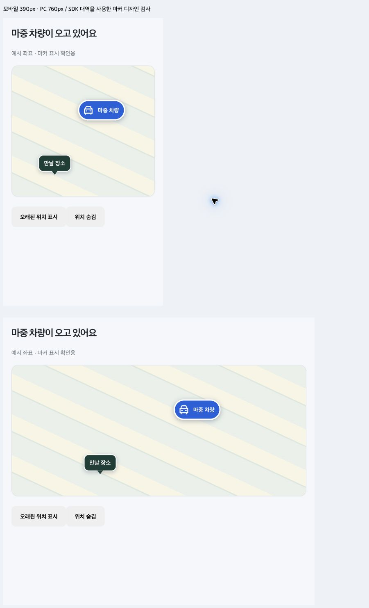

# 픽업 지도 표시

차량 위치는 파란 차 아이콘과 `마중 차량` 이름표로 표시한다. 확정한 만날 장소는 초록색 말풍선으로 표시한다. 만날 장소는 탑승자의 실시간 GPS 위치가 아니다.

차량 정보가 오래되면 회색 점선과 `마지막 위치` 문구로 바뀐다. 위치가 더 이상 유효하지 않으면 차량 마커를 숨긴다. 이때도 확정된 만날 장소는 남는다. 차량과 장소가 같아져도 이름표가 겹치지 않도록 위·아래로 배치한다.

기존 지도에서 보이던 작은 `차` 글자는 차량 마커의 스타일이 없어 발생한 표시 문제였다. 차량 좌표가 없는 경우에는 임의 위치에 차 아이콘을 표시하지 않는다.

검증: 지도 재사용·위치 갱신·오래된 위치 표시·위치 제거를 포함한 Node 테스트 75개 통과. 모바일·PC 크기 화면은 SDK 대역과 예시 좌표로 확인했다. 실제 휴대전화 주행 시험과는 구분한다.

