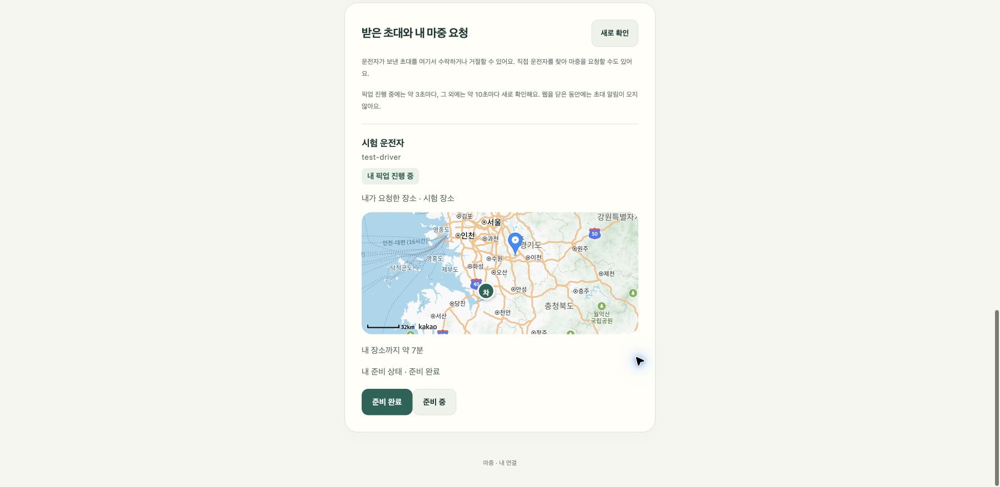

# 탑승자 지도

기능: 3.5 탑승자 지도. 카카오맵에 약속 장소와 차량 위치를 표시한다. 지도는 표시 전용이다. 경로를 계산하지 않고 카카오 장소 ID를 차량으로 보내지 않는다.

## 동작

- `/api/v1/config`의 `kakaoMapJavaScriptKey`가 있을 때만 카카오맵 SDK를 불러온다. 키가 없거나 8초 안에 불러오지 못하면 지도 없이 기존 화면을 유지한다. 잘못된 SDK 응답도 처리하고 다음 로딩을 허용한다.
- 초대 링크 화면(`/`)과 계정 화면(`/account`)의 내 픽업 진행 중 항목에 표시한다.
- 약속 장소는 기본 마커, 차량은 `차` 원형 표시다. 30초가 지난 정보는 차량 표시를 흐리게 하고, 2분이 지나 서버가 좌표를 숨기면 차량 표시를 지운다([끊김 표시](vehicle-freshness.md)).
- 차량이 처음 보이거나 사라질 때만 두 지점에 맞춰 지도를 이동한다. 이후 갱신에서는 사용자가 옮긴 지도 위치를 유지한다.
- 화면을 다시 그려도 지도 요소를 새로 만들지 않고 같은 지도를 옮겨 붙인다.

## 배포 전 준비

1. 서버 [카카오맵 키 설정](https://github.com/majung-team/majung-backend/blob/main/docs/kakao-map.md)에 따라 JavaScript 키와 Web 플랫폼 도메인을 등록한다.
2. `deploy/Caddyfile`의 CSP에 `https://dapi.kakao.com`·`https://t1.daumcdn.net`(스크립트), `https://*.daumcdn.net`(지도 이미지)을 추가했다. Caddy 설정은 CI가 바꾸지 않으므로 서버에 직접 반영한다.
3. 새 파일 `map.js`를 서버 배포 스크립트의 웹 파일 목록에 추가했다(서버 PR). 설치된 `/usr/local/sbin/majung-deploy`를 갱신한 뒤 웹을 배포한다. 갱신 전에 배포하면 알 수 없는 파일로 거절된다.

## 확인 범위

- 로컬 서버·개발 웹·헤드리스 Chrome: 지도 키가 없을 때 기존 화면 유지, 30초 경과 흐림·"마지막 갱신 35초 전", 2분 경과 "위치 확인 중", 콘솔 오류 없음.
- 카카오 SDK 대역 객체로 `map.js` 호출 순서 확인: 장소·차량 표시 → 두 지점 맞춤 → 이동 시 재맞춤 없음 → 좌표 없으면 차량 제거.
- 실제 카카오맵 키로 지도를 띄운 결과, CSP에서 추가로 막히는 주소가 있는지, 실제 휴대전화 화면은 아직 확인하지 않았다.

## 운영 연결 · 2026-10-26

카카오 담당자의 [무료 쿼터 이관 답변](https://devtalk.kakao.com/t/topic/152375/2)을 확인하고 마중 전용 앱의 지도 API를 활성화했다. HANMAP 지도는 OFF 상태다. 유료 월렛은 연결하지 않았다.

마중 전용 JavaScript 키를 서버 환경변수에 저장하고 `https://majung.cloud`, 로컬 시험 주소 `http://127.0.0.1:4183`을 등록했다. 로그인 REST 키·관리자 키는 지도 설정에 사용하지 않는다. 운영 Caddy는 문법 검증 후 지도 스크립트·타일 도메인만 허용하도록 반영했다.

최신 자동 연결·푸시·ETA 갱신 main과 지도 브랜치를 합쳤다. 자동 시험 31건과 JavaScript 구문 검사를 통과했다. 실제 카카오 SDK로 로컬 가상 계정의 약속 장소·차량 마커를 표시했고 콘솔 오류는 없었다. 실차 위치·모바일 화면 시험은 별도다.

지도 이미지는 실제 카카오 SDK이고 픽업·좌표·계정은 시험 데이터다.
