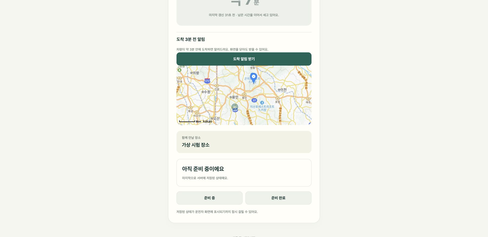

# 탑승자 지도 및 카카오맵 연동

마중 모바일 웹은 카카오맵 JavaScript SDK를 이용해 탑승자의 약속 장소와 차량 위치를 지도에 표시한다.

지도는 **현재 위치와 만남 장소를 확인하기 위한 표시 전용 기능**이다. 차량의 내비게이션 경로를 계산하거나 교통 상황을 분석하지 않는다.

차량 위치와 예상 도착 시간(ETA)은 백엔드에서 허용된 정보만 사용하며, 카카오 장소 ID를 차량 앱으로 전달하지 않는다.

이 문서는 기능 3.5의 지도 동작, SDK 로딩, 위치 최신성 처리, 운영 설정 및 검증 결과를 설명한다.

---

## 1. 주요 기능

| 항목 | 동작 |
| --- | --- |
| 지도 SDK | 카카오맵 JavaScript SDK |
| 약속 장소 | 기본 지도 마커 |
| 차량 위치 | `차` 문구가 있는 원형 마커 |
| 차량 정보 최신 | 정상 표시 |
| 차량 정보 30초 초과 | 차량 마커 흐림 처리 |
| 차량 정보 2분 초과 | 서버 응답에 좌표가 없으면 마커 제거 |
| 지도 초기 이동 | 차량 위치가 처음 나타나거나 사라질 때 화면 범위 조정 |
| 사용자 지도 조작 | 이후 갱신에도 지도 위치 유지 |
| SDK 로딩 실패 | 지도를 제외한 기존 화면 유지 |

### 사용 화면

지도는 다음 화면에서 제공한다.

- 초대 링크로 접근한 픽업 화면(`/`)
- 로그인한 계정의 진행 중 픽업(`/account`)

두 화면은 같은 지도 표시 정책을 사용한다.

---

## 2. 지도 표시 구조

마중의 지도는 픽업 장소와 서버에서 받은 차량 위치를 표현한다.

```text
차량 앱
   │
   │ SDK 위치·ETA
   ▼
마중 백엔드
   │
   │ 접근 권한·최신성 검사
   ▼
모바일 웹
   │
   ├── 확정된 약속 장소
   │
   ├── 허용된 차량 좌표
   │
   └── 차량 정보 최신성 상태
            │
            ▼
       카카오맵 SDK
            │
            ▼
       지도·마커 표시
```

웹은 SDK로부터 직접 차량 위치를 조회하지 않는다.

또한 두 지점 사이의 이동 경로, 교통량 또는 실제 도착 시간을 별도로 계산하지 않는다.

---

## 3. 카카오맵 SDK 로딩

지도 SDK는 서버 설정에 따라 조건부로 불러온다.

### 공개 설정 API

```http
GET /api/v1/config
```

응답의 `kakaoMapJavaScriptKey`가 설정되어 있는 경우에만 카카오맵 SDK를 로딩한다.

### 로딩 조건

1. 서버에서 지도 JavaScript 키 확인
2. 키가 있는 경우 SDK 로딩 시작
3. 최대 8초 동안 로딩 결과 확인
4. SDK 객체와 초기화 가능 여부 확인
5. 성공 시 지도 생성
6. 실패 시 기존 화면 유지

### 지도 기능 비활성화

다음 상황에서는 지도 없이 기존 픽업 화면을 유지한다.

- JavaScript 키 없음
- SDK 로딩 실패
- 8초 내 로딩 완료되지 않음
- 예상하지 못한 SDK 응답
- 지도 초기화 실패

지도 로딩 실패가 로그인, 픽업 상태 조회 또는 준비 상태 변경을 중단시키지 않도록 한다.

잘못된 SDK 응답이 발생한 뒤에도 다음 지도 로딩 시도를 허용한다.

---

## 4. 지도 마커

### 약속 장소 마커

현재 확정된 약속 장소를 기본 마커로 표시한다.

제안된 장소가 있더라도 차량에서 확정하기 전까지 기존 약속 장소를 기준으로 한다.

### 차량 위치 마커

서버가 제공한 차량 좌표에 `차` 문구가 표시된 원형 마커를 사용한다.

실제 차량 위치는 서버가 제공한 최신성 상태에 따라 표현한다.

### 최신성 상태

| 서버 상태 | 지도 표시 |
| --- | --- |
| `FRESH` | 차량 마커 정상 표시 |
| `STALE` · 마지막 좌표 제공 | 차량 마커 흐림 처리 |
| `STALE` · 좌표 없음 | 차량 마커 제거 |
| `WAITING` | 차량 마커 표시하지 않음 |

기본 정책은 다음과 같다.

- 30초 이내: `FRESH`
- 30초 초과: `STALE`
- 2분 초과: 차량 좌표 제공 중단

30초와 2분은 서버 정책의 초기 설정값이며, 웹이 독립적으로 차량 데이터의 유효성을 결정하는 기준은 아니다.

[차량 정보 최신성](vehicle-freshness.md)

---

## 5. 지도 화면 범위 조정

지도는 약속 장소와 차량 위치를 함께 확인할 수 있도록 초기 범위를 조정한다.

### 자동 범위 조정 조건

- 차량 위치가 처음 표시될 때
- 기존 차량 위치가 사라질 때

차량 마커가 추가되거나 제거되면 현재 표시할 지점을 기준으로 지도 범위를 조정한다.

### 사용자 조작 유지

이후 차량 위치가 갱신될 때마다 지도를 다시 중앙으로 이동시키지 않는다.

탑승자가 지도를 직접 이동하거나 확대·축소했다면 해당 조작을 유지한다.

이를 통해 차량 위치가 주기적으로 변경되는 동안 지도 화면이 계속 초기 위치로 돌아가는 문제를 방지한다.

---

## 6. 지도 인스턴스 재사용

픽업 화면은 상태 변경에 따라 DOM을 다시 렌더링할 수 있다.

이때 지도 객체를 매번 새로 생성하지 않는다.

### 처리 방식

1. 지도 객체 생성
2. 약속 장소 및 차량 마커 표시
3. 화면 갱신
4. 기존 지도 DOM 요소 재사용
5. 필요한 마커 상태만 변경

화면을 다시 그리더라도 동일한 지도 요소를 새 화면 위치로 옮겨 붙인다.

### 재사용 목적

- 불필요한 SDK 초기화 방지
- 지도 타일 재로딩 감소
- 사용자 확대·축소 상태 보존
- 화면 갱신 시 깜빡임 감소

지도 재사용은 실제 구현된 DOM 처리 방식이며, 별도 성능 수치가 측정됐다는 의미는 아니다.

---

## 7. 운영 지도 API 설정

카카오맵 SDK를 운영 환경에서 사용하려면 카카오 개발자 콘솔과 백엔드 설정이 필요하다.

### 카카오 앱 설정

마중 전용 카카오 앱에서 지도 API를 활성화한다.

카카오맵 JavaScript 키와 허용 Web 플랫폼 도메인을 등록한다.

운영 주소:

```text
https://majung.cloud
```

로컬 시험 주소:

```text
http://127.0.0.1:4183
```

마중 지도 설정은 로그인용 REST API 키나 관리자 키와 구분한다.

### 키 저장

지도 JavaScript 키는 서버 환경변수에서 관리하고, 공개 설정 API로 웹에 제공한다.

카카오맵 JavaScript 키는 브라우저 SDK 실행에 필요한 공개 클라이언트 식별자다.

카카오 Client Secret이나 관리자 인증 키와 혼동하지 않는다.

[백엔드 카카오맵 설정](https://github.com/majung-team/majung-backend/blob/main/docs/kakao-map.md)

---

## 8. Content Security Policy 설정

카카오맵 SDK는 초기 스크립트 외에도 추가 스크립트, 지도 타일 및 아이콘을 외부 CDN에서 불러온다.

운영 환경은 Caddy의 Content Security Policy(CSP)를 통해 필요한 출처만 허용한다.

### 스크립트 허용 출처

- `https://dapi.kakao.com`
- `https://t1.daumcdn.net`
- `https://t1.kakaocdn.net`

### 이미지 허용 출처

- `https://*.daumcdn.net`
- `https://t1.kakaocdn.net`
- `https://mts.kakaocdn.net`

위 목록은 마중의 2026년 10월 26일 운영 시험에서 확인한 허용 출처다.

SDK의 외부 리소스 출처가 변경될 수 있으므로 SDK 업데이트 시 실제 네트워크 요청과 CSP 차단 로그를 함께 확인해야 한다.

### 설정 반영

Caddy 설정은 일반 웹 CI/CD 배포에서 자동으로 변경하지 않는다.

운영자가 설정을 검토한 뒤 문법 검증과 reload를 수행한다.

웹 코드 배포와 운영 프록시 설정 변경은 별도로 관리한다.

---

## 9. 웹 배포 파일 허용 목록

지도 기능을 추가하면서 웹 정적 파일에 `map.js`가 추가됐다.

기존 서버 배포 프로그램은 허용된 파일만 배포할 수 있으므로 새 파일을 허용 목록에 반영해야 했다.

### 적용 대상

```text
map.js
```

### 필요한 작업

1. 서버 저장소의 웹 배포 파일 허용 목록 수정
2. 운영 서버의 설치된 배포 프로그램 갱신
3. 새로운 웹 정적 파일 배포
4. 공개 HTTPS에서 지도 스크립트 로딩 확인

운영 배포 프로그램 경로:

```text
/usr/local/sbin/majung-deploy
```

기존 허용 목록을 수정하지 않은 상태에서 `map.js`가 포함된 웹 아카이브를 배포하면 알 수 없는 파일로 거부될 수 있다.

따라서 서버 배포 정책 변경을 웹 배포보다 먼저 반영한다.

---

## 10. 초기 로컬 테스트

지도 기능의 초기 시험은 다음 환경에서 수행했다.

- 로컬 Spring Boot 서버
- 개발 웹 서버
- 헤드리스 Chrome
- 카카오맵 SDK 대역 객체

### 지도 SDK 비활성화

JavaScript 키가 없는 경우:

- 지도 SDK 미호출
- 기존 픽업 화면 유지
- 지도 오류로 다른 기능 중단되지 않음

### 정보 최신성

30초가 지난 차량 정보를 다음과 같이 표시하는지 확인했다.

- 차량 마커 흐림
- `마지막 갱신 35초 전` 안내

2분이 지난 경우:

- 서버 응답에서 차량 좌표 제거
- 차량 마커 숨김
- `위치 확인 중` 안내

해당 시험에서 브라우저 콘솔 오류가 없음을 확인했다.

### SDK 호출 순서

카카오맵 SDK 대역 객체로 다음 흐름을 검증했다.

1. 약속 장소 마커 표시
2. 차량 마커 표시
3. 두 지점이 보이도록 범위 조정
4. 사용자가 지도 이동
5. 이후 차량 위치 갱신 시 자동 범위 조정하지 않음
6. 좌표가 없어지면 차량 마커 제거

지도 표시 정책과 사용자 조작 유지 동작을 확인한 시험이다.

---

## 11. 운영 지도 연동 — 2026년 10월 26일

### 지도 API 활성화

카카오 담당자의 [무료 쿼터 이관 안내](https://devtalk.kakao.com/t/topic/152375/2)를 확인한 뒤 마중 전용 카카오 앱의 지도 API를 활성화했다.

당시 운영 설정:

| 항목 | 상태 |
| --- | --- |
| 마중 지도 API | 활성화 |
| HANMAP 지도 | 비활성화 |
| 유료 월렛 | 연결하지 않음 |
| 운영 Web 도메인 | 등록 |
| 로컬 시험 도메인 | 등록 |

이는 당시 설정 기록이며, 향후 요금제나 카카오 지도 API 정책이 동일하게 유지된다는 뜻은 아니다.

### 웹 코드 통합

당시 최신 `main`의 다음 기능을 지도 브랜치와 통합했다.

- 초대 링크 자동 참여
- 도착 임박 푸시
- ETA 갱신

### 테스트 결과

| 항목 | 결과 |
| --- | --- |
| 웹 자동 테스트 | 31건 통과 |
| JavaScript 구문 검사 | 통과 |
| 실제 카카오맵 SDK 로딩 | 확인 |
| 로컬 가상 픽업 마커 | 확인 |
| 브라우저 콘솔 오류 | 없음 |

로컬 가상 계정과 시험 픽업을 이용해 실제 카카오 SDK로 약속 장소와 차량 마커를 표시했다.


위 이미지는 실제 카카오맵 SDK로 렌더링한 화면이다.

픽업·좌표·계정은 시험 데이터이며 실제 사용자의 위치가 아니다.

---

## 12. 운영 CSP 문제와 해결

운영 공개 HTTPS에서 실제 지도 SDK를 로딩하는 과정에서 추가 CDN 요청을 확인했다.

### 발생한 문제

기존 CSP에는 `t1.daumcdn.net` 등의 카카오맵 리소스 출처가 허용되어 있었다.

하지만 실제 SDK가 추가로 다음 호스트의 스크립트를 요청했다.

```text
t1.kakaocdn.net
```

운영에서 확인한 SDK 스크립트 버전은 `4.5.29`였다.

또한 지도 타일과 아이콘 일부가 다음 호스트에서 제공됐다.

```text
mts.kakaocdn.net
t1.kakaocdn.net
```

기존 CSP 허용 목록만으로는 지도 리소스 로딩이 완료되지 않았다.

### 해결 과정

1. 운영 HTTPS에서 지도 로딩 실패 확인
2. 브라우저 네트워크 요청 및 CSP 차단 출처 확인
3. 추가 스크립트 CDN 확인
4. 지도 타일·아이콘 제공 호스트 확인
5. Caddy의 CSP 허용 목록 수정
6. Caddy 문법 검증
7. Caddy reload
8. 공개 HTTPS에서 실제 리소스 로딩 재확인

### 수정 내용

스크립트 허용 목록에 다음 호스트를 추가했다.

```text
https://t1.kakaocdn.net
```

지도 이미지 허용 목록에도 다음 호스트를 반영했다.

```text
https://mts.kakaocdn.net
https://t1.kakaocdn.net
```

### 해결 결과

공개 HTTPS에서 다음 항목이 실제로 로딩되는 것을 확인했다.

- 카카오맵 SDK
- 지도 타일
- 약속 장소 마커
- 차량 위치 마커
- 지도 로고 및 아이콘



위 화면은 운영 HTTPS 환경에서 가상 픽업 데이터를 사용해 확인한 결과다.

실제 사용자의 위치 또는 실차 주행 데이터는 아니다.

---

## 13. 검증 범위와 제한

### 확인한 항목

- 카카오맵 JavaScript SDK 로딩
- 지도 키 미설정 시 대체 화면 유지
- SDK 로딩 실패·타임아웃 처리
- 약속 장소 및 차량 마커
- 차량 정보 경과 시간에 따른 표시 변경
- 차량 좌표 제거 시 마커 삭제
- 사용자 지도 조작 유지
- 지도 인스턴스 재사용
- 실제 SDK 기반 로컬 브라우저 연동
- 공개 HTTPS의 타일·마커·로고 로딩
- 운영 CSP 오류 수정

### 별도 검증 항목

- 실제 휴대전화의 지도 사용성
- Android·iOS 모바일 브라우저별 동작
- 실제 휴대전화 GPS 정확도
- 실차 차량 위치 데이터
- 주행 중 연속 좌표 갱신
- LTE·Wi-Fi 전환 중 지도 상태 복구
- 장시간 지도 실행 시 메모리 사용량

로컬 브라우저와 운영 HTTPS의 시험 픽업으로 확인한 결과를 실제 휴대전화 또는 실차 검증 완료로 표현하지 않는다.

---

## 14. 관련 문서

- [웹 README](../README.md)
- [웹 화면 사용 흐름](service-screens.md)
- [차량 정보 최신성](vehicle-freshness.md)
- [장소 선택 및 제안](place-proposal.md)
- [초대 링크 자동 참여](auto-connect.md)
- [GitHub Actions 웹 배포](github-actions.md)
- [백엔드 카카오맵 설정](https://github.com/majung-team/majung-backend/blob/main/docs/kakao-map.md)
- [백엔드 차량 최신성 정책](https://github.com/majung-team/majung-backend/blob/main/docs/vehicle-state.md)
- [개발 현황 및 검증 기록](https://github.com/majung-team/majung/blob/main/docs/development-status.md)

---

## 문서 관리 기준

이 문서는 탑승자 지도 기능의 SDK 로딩, 마커 표시, 정보 최신성, 운영 설정 및 검증 결과를 설명한다.

다음 항목을 구분하여 기록한다.

- 표시용 웹 지도와 차량 내비게이션 경로
- 차량 정보 최신성과 지도 표시 상태
- SDK 대역 객체 시험과 실제 카카오 SDK 시험
- 로컬 브라우저와 공개 HTTPS 검증
- 가상 픽업 좌표와 실제 실차 위치
- 웹 정적 파일 배포와 Caddy 보안 설정 변경

카카오맵 SDK 또는 CSP 설정을 변경하면 실제 리소스 요청과 지도 렌더링 결과를 함께 확인한다.
