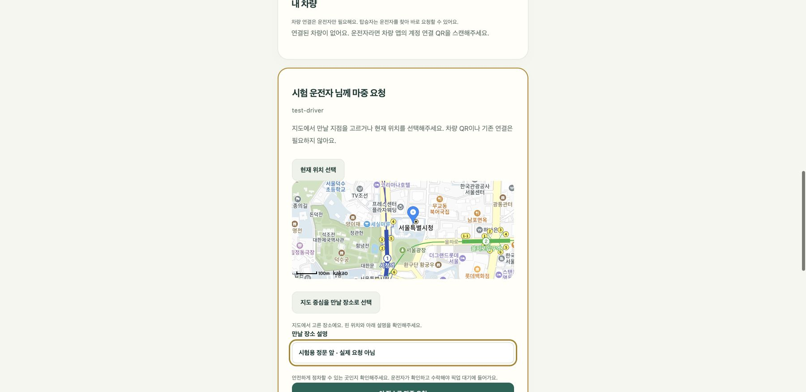

# 마중 요청 장소 고르기

운전자를 검색해 ‘마중 요청’을 누른다. 현재 GPS 위치로 요청하거나 지도에서 만날 지점을 고를 수 있다. 장소 설명에는 정문·주차장 입구처럼 서로 구분할 수 있는 내용을 적는다.

1. 지도를 이동해 만날 지점을 누른다. 또는 지도의 가운데를 맞추고 ‘지도 중심을 만날 장소로 선택’을 누른다.
2. 핀이 생긴 위치를 확인한다. 지도를 열기만 했을 때는 장소가 선택되지 않는다.
3. 만날 장소 설명을 적고 요청한다. 운전자가 장소를 확인하고 수락하면 픽업 대기에 들어간다.

GPS 권한은 현재 위치 선택을 눌렀을 때만 요청한다. 지도 핀 선택에는 GPS 권한이 필요 없다. GPS 위치는 2분이 지나면 다시 받아야 하며, 직접 고른 고정 지점은 같은 방식으로 만료시키지 않는다. 지도 로딩에 실패하면 기존 현재 위치 요청을 사용할 수 있다.

선택한 좌표와 설명만 기존 요청 API에 보낸다. 카카오 장소 ID를 내비에 넘기거나 경로를 계산하지 않는다. 진행 중인 픽업의 장소 변경 기능도 아니다. 사람이 안전하게 정차할 수 있는 장소인지 확인해야 한다.

## 검증

- 웹 자동 시험 36건: 지도 기본 중심점 자동 선택 방지, 명시적 클릭·중심 선택, 처리 중 변경 차단, 리스너 정리, 잘못된 좌표 거절, 실제 계정 요청 코드의 선택 좌표·설명 전송, 오래된 GPS 차단.
- 실제 카카오 SDK·로컬 가상 계정에서 핀과 설명 입력, 요청 버튼 활성화를 확인했다.
- 실제 휴대전화 GPS와 차량 SDK의 경로 반영은 별도 시험이다.

[카카오 공식 클릭·마커 예제](https://apis.map.kakao.com/web/sample/addMapClickEventWithMarker/)를 기준으로 지도 이벤트를 연결했다.
