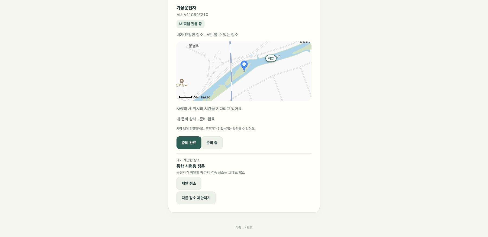

# 장소 제안

기능: 6.1 장소 제안. 탑승자가 지도에서 핀을 놓아 다른 만남 장소를 제안한다. 제안은 확정된 약속 장소를 바꾸지 않는다. 운전자가 확인하고 경로를 반영하는 일(6.2)은 차량 앱이 맡는다. API는 [서버 문서](https://github.com/majung-team/majung-backend/blob/main/docs/place-proposal.md)를 따른다.

## 화면

- 지도가 있고 픽업이 진행 중(`ACTIVE`)일 때만 `다른 장소 제안하기`가 보인다. 지도가 없으면(키 없음·로딩 실패) 제안 영역도 숨긴다.
- 누르면 지도에 초록 테두리가 생기고, 지도를 누른 곳에 `여기` 핀이 놓인다. 다시 누르면 핀이 옮겨진다.
- 장소 설명(예: 정문 앞)을 적고 `제안 보내기`를 누른다. 핀이 없거나 설명이 비어 있으면 보내지 않고 이유를 알려 준다. 설명은 120자까지다. 주소 검색은 쓰지 않으므로 설명은 직접 적는다.
- 보낸 뒤에는 `내가 제안한 장소`와 설명이 보이고, 지도에는 `제안` 표시가 확정 장소 마커와 따로 나타난다. `제안 취소`로 지울 수 있다.
- 운전자가 제안한 장소는 `운전자가 제안한 장소`로 보인다. 탑승자는 지울 수 없고 다른 장소를 제안해 바꿀 수 있다.
- 도착 후·종료 후에는 제안 영역을 보이지 않는다.

## 구현 메모

| 파일 | 역할 |
| --- | --- |
| `proposal.js` | 입력 검증, 제안 영역 마크업, 입력창이 있는 패널 |
| `map.js` | `update(..., proposal)`의 제안 마커, `startPicking`·`stopPicking`의 핀 |
| `app.js`, `account.js` | 초대 링크 화면과 계정의 내 픽업 화면에서 연결 |

- 패널은 처음 쓸 때 한 번 만들고 화면을 다시 그릴 때마다 같은 요소를 옮겨 붙인다. 지도와 같은 방식이라 입력 중인 글과 초점이 유지된다.
- 입력창에 초점이 있는 동안에는 초대 링크 화면의 주기적 다시 그리기를 멈추고, 초점이 빠지면 바로 그린다.
- 계정 화면은 `/ride-requests/{id}/place-proposal`을 쓴다. 내 계정 클라이언트의 허용 경로에 이 경로를 추가했다.
- 운전자용 개발 화면(`developmentToolsEnabled`)은 탑승자·운전자의 제안을 보여 주고 `제안 지우기`를 제공한다. 실제 운전자는 차량 앱을 쓰므로 웹에서 핀으로 제안하는 화면은 만들지 않았다.

## 배포 전 준비

1. 서버 `pickup` 테이블에 열을 추가한다(`add-place-proposal.sql`, 서버 문서 참고). 새 서버를 먼저 배포하면 시작 검사에서 실패한다.
2. 서버 배포 스크립트(`deploy/release.py`)의 웹 파일 목록에 `proposal.js`를 추가했다. 설치된 `/usr/local/sbin/majung-deploy`를 갱신하기 전에 웹을 배포하면 알 수 없는 파일로 거절된다.

## 확인한 범위

- 자동 시험: 입력 검증, 제안 영역 표시 조건, 지도 핀·제안 마커, 계정 경로 허용.
- 로컬 Chrome에 가짜 지도 SDK를 넣고 서버와 연결해 확인: 핀 없이 보내기 거절, 설명 없이 보내기 거절, 폴링 중에도 입력과 초점 유지, 제안 저장과 확정 장소 유지, 운전자 제안으로 교체, 내 제안 취소, 같은 장소 거절.
- 확인하지 못한 것: 실제 카카오맵 위에서 핀을 누르는 동작, 휴대전화 화면, 로그인이 필요한 계정 화면(`/account`)의 실제 동작.

## 최신 기능과 통합 시험 · 2026-10-26

`chore/place-proposal-integration`에서 최신 main의 새 요청 장소 검색·핀 선택·준비 상태 수신 확인을 유지하며 장소 제안 코드를 합쳤다. 이 기록은 로컬 통합 브랜치 검증이며 운영 반영 완료를 뜻하지 않는다.

- 웹 시험 48건 통과. 실제 계정 진입 코드에서 수신 확인과 별도 제안을 동시에 표시하는 회귀 시험 포함.
- 실제 Spring 서버·Security·H2와 가상 로그인, 실제 카카오 SDK로 계정 화면의 핀 선택·설명·제안 저장·취소를 확인.
- 준비 완료와 차량 수신 확인을 처리해도 제안·확정 장소가 유지됐다. 제안을 취소해도 준비 상태·수신 확인은 유지됐다.
- 운영 공개 서버의 데이터나 실제 카카오 계정을 시험에 사용하지 않았다. 지도 이미지만 실제 SDK이며 계정·좌표·픽업은 가상 시험 데이터다.

차량 승인과 새 경로 확인 후 장소 확정은 다음 연결 작업이다. DB 열과 서버 배포 허용 목록을 먼저 준비해야 하며, 웹만 먼저 운영에 올리지 않는다.
