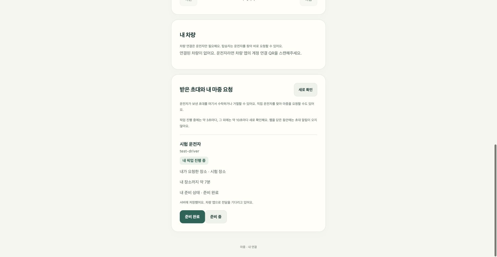

# 준비 상태가 차량에 전달됐는지 확인하기

준비 중·준비 완료를 누르면 먼저 서버에 저장한다. 그다음 차량 앱이 받은 사실을 확인해서 화면에 표시한다. 초대 링크 참여 화면과 로그인한 마중 요청 화면에 동일하게 적용한다.

| 표시 | 뜻 |
| --- | --- |
| 준비 상태를 선택하면 차량에 전달 | 아직 선택하지 않음 |
| 서버에 저장 · 차량 앱으로 전달 대기 | 저장됐지만 차량 수신 확인은 없음 |
| 차량 앱에 전달 | 차량 앱에서 해당 준비 상태를 수신함 |
| 연결이 끊겨 확인하지 못함 | 브라우저의 최신 조회 실패 |

운전자가 읽었는지는 알 수 없다. 차량 앱이 꺼져 있거나 이전 APK면 대기로 남을 수 있다. 준비 상태를 다시 바꾸면 새 순번의 수신 확인을 기다린다. 이전 상태의 확인을 새 상태에 재사용하지 않는다.

서버는 추가 응답 필드를 내려주며, 차량 APK가 수신 확인을 보내야 전달 완료로 바뀐다. 기존 서버·APK와 연결된 상태는 ‘아직 확인되지 않음’으로 표시한다.

웹 자동 시험 33건 통과. 실제 계정 화면 코드를 실행해 대기 → 전달 완료 → 새 상태 대기를 확인했다. 실차·운전자 열람 여부를 검증한 결과는 아니다.

