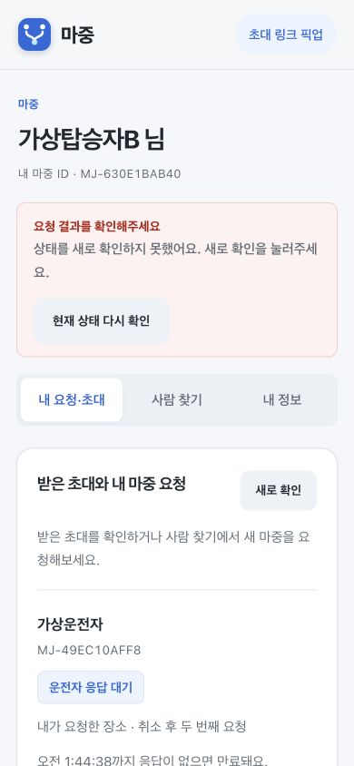

# 요청 취소·뒤로가기·재요청 확인

2026년 11월 6일. 운영 계정과 분리한 로컬 Spring Boot/H2 서버와 Chrome에서 확인했다. 인증은 가상 공급자를 사용했다. 실제 사용자 픽업은 변경하지 않았다.

## 발견하고 고친 부분

- 요청 작성 중 브라우저 뒤로가기를 누르면 사람 찾기 대신 이전 로그인 화면으로 이동했다. 이제 작성 화면을 닫고 사람 찾기로 돌아간다.
- 작성 중 다른 메뉴로 이동하면 숨겨진 장소·작성 폼이 남았다. 메뉴를 바꾸면 작성 상태를 정리한다.
- GPS를 기다리다가 뒤로간 경우, 늦게 온 결과가 닫힌 폼에 남지 않도록 요청 식별자를 대조한다.
- 브라우저 캐시에서 복귀하면 이전 위치·ETA를 먼저 지우고 서버 상태를 새로 조회한다. 요청 전송을 자동 재시도하지 않는다.
- 새 요청을 시작할 때 이전 취소 안내를 지운다.

## 직접 확인한 흐름

| 흐름 | 결과 |
| --- | --- |
| 사람 찾기 → 요청 작성 → 브라우저 뒤로가기 | 사람 찾기로 복귀. 로그인 화면으로 빠지지 않음 |
| 작성 화면 재진입 | 장소와 설명을 새로 선택해야 함 |
| 요청 → 취소 확인 → 돌아가기 | 기존 요청 유지 |
| 요청 취소 확정 → 같은 운전자에게 새 요청 | 이전 요청 취소 상태 유지, 새 요청 응답 대기 |
| 새 요청 완료 → 뒤로가기 → 앞으로가기 → 새로고침 | 새 요청 1건과 취소된 요청 1건 유지 |
| 모바일 390px 화면 | 가로 넘침 없음 |
| 시험 서버 종료 후 상태 조회 | 연결 실패 안내와 재조회 버튼 표시 |

마지막 연결 실패는 15분 제한이 있는 시험 서버가 종료되면서 발생했다. 운영 서버 장애를 재현한 기록은 아니다.

## 자동 시험

- 웹: `npm test` 94개 통과. 중복 제출, 취소 확인 중 ACTIVE 전환, 작성 중 뒤로가기, 늦은 GPS 결과, 캐시 복귀를 포함한다.
- 서버: 전체 시험 116개 통과, 수동 실행용 브라우저 fixture 1개 제외. PENDING·QUEUED 취소 후 재요청, 취소된 식별자 재전송, 만료 후 다른 장소 재요청을 추가했다.
- 차량 앱: `:vehicle:testDebugUnitTest` 69개 통과. 이번 변경으로 차량 코드를 수정하거나 APK를 교체하지 않았다.

실제 iPhone Safari의 뒤로가기 캐시 동작, 실차 시동 종료 시험은 이 기록에 포함하지 않는다.
