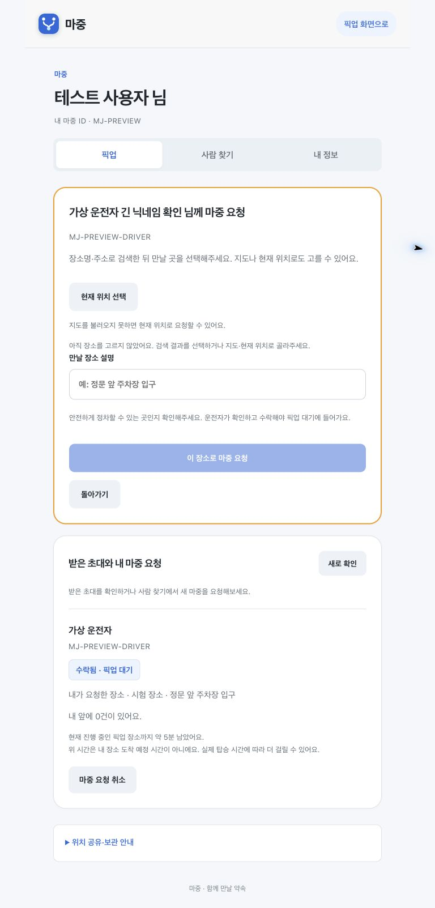

# 웹 화면 점검 · 2026년 10월 28일

## 수정한 부분

버튼을 누를 때 모양 전체를 축소하는 효과를 없애고 배경색으로 눌림을 표시한다. 전환 대상을 색상으로 제한해 너비·여백이 함께 움직이지 않게 했다. 회색 버튼의 불필요한 테두리와 첫 화면 시작 버튼의 강한 그림자를 줄였다.

카드가 클릭 가능한 것처럼 보이던 hover 그림자 변화도 없앴다. 긴 제목과 버튼은 줄바꿈할 수 있고 새로 확인 버튼은 최소 높이 44px로 맞췄다. 연결 목록의 동작 버튼은 같은 줄의 공간을 나눠 쓴다.

탭 본문은 좌우 48px에서 240ms 동안 들어온다. 전환 중 화면 밖으로 나간 카드 때문에 가로 스크롤이 생기지 않도록 처리했다. 선택 표시·키보드 포커스·동작 줄이기는 유지한다.

## 확인 범위

운영과 동일하게 인라인 스타일을 차단한 로컬 서버에서 가상 응답을 사용했다. 실제 계정 변경·픽업 요청·위치 권한 허용은 하지 않았다.

| 상태 | 확인 내용 |
| --- | --- |
| 첫 화면·로그인 | 320px에서 문구·버튼 배치, 로그인 안내와 버튼 사이 24px |
| 픽업·사람 찾기·내 정보 | 320·390·768px에서 가로 넘침, 선택 표시·메뉴 전환 |
| 검색 결과·연결 목록 | 긴 닉네임·ID와 동작 버튼 줄바꿈 |
| 마중 요청 폼 | 320·390·768px에서 입력칸·안내·버튼 잘림 검사 |
| 픽업 대기 | 다른 픽업 남은 시간 안내와 취소 버튼 배치 |
| 진행 중 픽업 | 320px에서 ETA·준비 상태 버튼·하단 메뉴 배치 |

웹 테스트 64개 통과. 실제 휴대전화 Safari와 카카오 지도 타일 렌더링, 실기기 푸시 수신은 이번 화면 검사에서 재시험하지 않았다.

