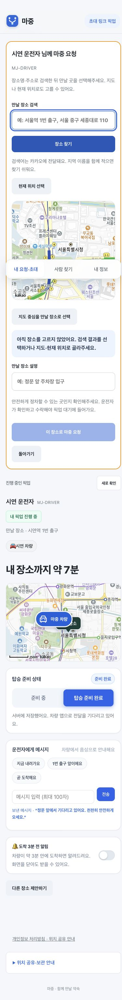
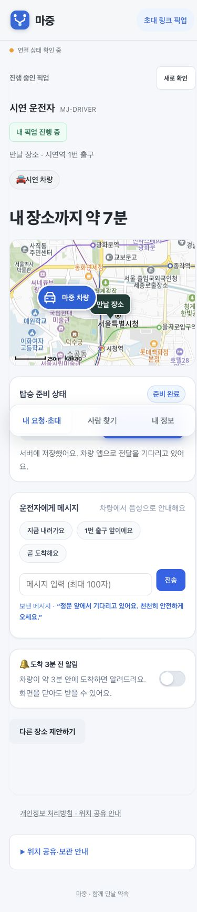

# 픽업 화면 사용성 보완

2026년 11월 5일 기준 변경 사항이다. 초대 링크와 로그인한 계정의 픽업 화면을 같은 준비 상태·메시지 조작으로 맞췄다.

## 장소 선택

마중 요청 지도에 높이와 최소 높이를 지정했다. 기존에는 진행 중인 픽업 지도에만 높이가 있어, 새 요청 지도는 0px로 표시됐다. 390px 모바일 화면에서 약 304px 높이로 표시되는 것을 확인했다. 선택한 장소와 검색 주소를 요청 버튼 위에 표시한다. 장소를 고르기 전에는 요청할 수 없다.

## 준비 상태와 전달 확인

- 전송 중에는 선택 표시가 움직이고 ‘보내는 중’을 표시한다. 같은 준비 상태 요청을 중복 전송하지 않는다.
- 서버 저장과 차량 앱의 수신 확인을 구분한다. 운전자가 읽었거나 내비에 표시됐다고 추정하지 않는다.
- 실패하면 마지막 서버 상태로 돌아가고 다시 보내기를 제공한다.
- 준비 상태 전송 전 시작한 조회 결과가 늦게 와도 새 상태를 덮어쓰지 않는다.

## 차량 연결과 화면 구성

같은 차량명이 여러 번 표시되면 구분 코드와 계정 연결 시각으로 구분한다. 해제 확인창에도 같은 정보를 표시한다. 연결 시각은 API의 `linkedAt`이며 마지막 운행 시각이 아니다.

메뉴 이름을 ‘내 요청·초대’로 통일하고, 초대 링크의 픽업 화면과 구분했다. 모바일 안내 글자와 조작 영역을 키웠고 시스템의 동작 줄이기 설정을 따른다. 오류 안내에는 현재 상태를 다시 조회하는 버튼을 제공한다.

## 확인 결과

웹 회귀 시험 81건 통과. 준비 상태 중복 전송·실패 후 재시도·차량 수신 확인·동일 이름 차량의 해제 확인을 포함한다. Chrome 데스크톱과 390 × 844 화면에서 실제 웹 모듈과 카카오 지도로 확인했다. 계정과 픽업 API 응답은 로컬 시험 데이터이며 실기기·실차 시험을 대신하지 않는다.

