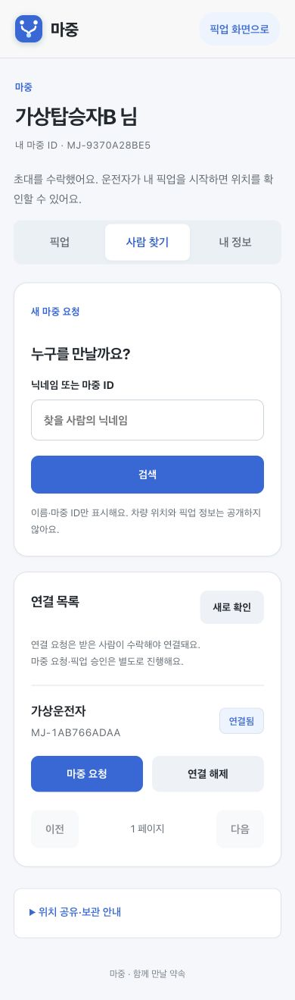

# 연결된 사람에게 다시 요청하기

2026년 10월 28~29일 Chrome과 로컬 Spring 서버의 가상 계정으로 확인했다. 공개 서버에서는 화면·메뉴만 확인했으며 실제 계정의 연결을 해제하거나 다른 사람에게 요청하지 않았다.

## 고친 부분

- 자동 조회 중에는 탭 클릭이 무시될 수 있었다. 자동 조회와 사용자 작업의 진행 상태를 나눴다. 탭은 바로 이동하고, 서버 내용을 바꾸는 작업은 진행 중인 조회가 끝난 뒤 한 번 실행한다.
- 연결 목록에 `마중 요청`을 추가했다. 닉네임을 다시 검색하지 않아도 된다. 동명이인을 잘못 고르지 않도록 목록의 고유 마중 ID와 일치하는 계정을 확인한 뒤 장소 선택을 연다.
- 장소 선택에서 돌아가면 사람 찾기 목록으로 돌아온다. 사람을 고르는 것만으로 요청을 보내지 않는다.
- 초대 수락·거절, 마중 요청 취소, 차량 연결 해제는 페이지 안에서 대상과 영향을 확인한다. `확인` 대신 실제 동작 이름을 버튼에 표시한다.
- 확인 화면을 열고 난 뒤 초대가 만료되는 등 상태가 바뀌면 이전 선택을 전송하지 않는다.

## 확인한 범위

- 웹 자동 시험 70개 통과. 지연된 자동 조회 중 탭 이동, 작업 순서, 동명이인, 대상 조회 실패, 확인 전 미전송, 중복 확정 방지, 만료 후 미전송 포함.
- 로컬 가상 탑승자가 초대를 수락한 뒤 `내 앞에 1건`인 대기 화면 확인. 현재 진행 중인 픽업의 시간과 내 장소 도착 시간이 별개라는 안내 유지.
- 연결 목록에서 사람을 골라 장소 입력 화면으로 이동하고, 돌아가기 후 목록으로 복귀 확인.
- Chrome 390 × 844 화면에서 버튼·카드 배치와 가로 넘침 없음 확인.

지도 검색·실제 휴대전화 GPS·실기기 푸시의 새 검증 결과는 아니다. 장소를 고르지 않은 상태에서 요청 버튼이 비활성화되는 것은 기존 동작을 유지한다.

