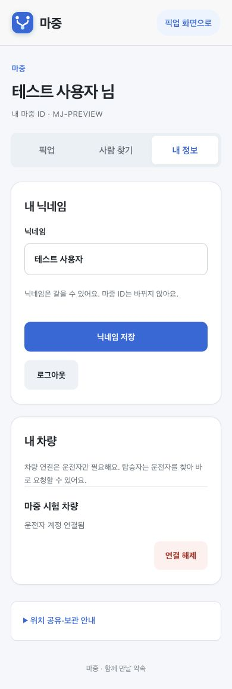

# 내 차량의 연결 해제 버튼

차량 이름과 버튼이 같은 문단에 붙어 있던 배치를 바꿨다.
차량 이름과 연결 상태는 정보 영역에, 연결 해제는 별도 동작 영역에 표시한다.
좁은 화면에서는 버튼을 다음 줄 오른쪽에 배치한다.

시험 계정으로 390px 화면에서 가로 넘침이 없고 버튼 높이가 48px인지 확인했다.
이름을 포함한 접근성 이름으로 어떤 차량의 연결을 해제하는지 구분한다.
연결 해제 확인과 API 호출 절차는 기존 그대로다. 실제 계정의 차량 연결을 해제하지 않았다.
