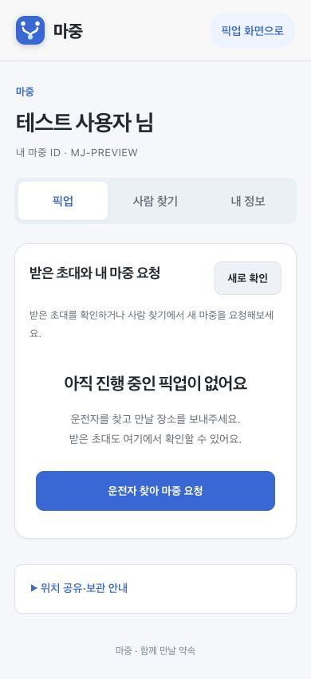
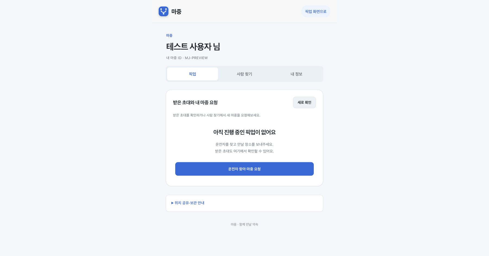

# 웹 로고와 아이콘

상단 로고의 M 문자를 두 지점이 한곳에서 만나는 심볼로 바꿨다. 탭 아이콘과 휴대전화 홈 화면 아이콘도 같은 모양을 사용한다. SVG 원본은 `favicon.svg`이고 PNG는 64·180·192·512px로 나눴다.

아이콘은 GitHub Actions 웹 압축 파일과 서버 배포 도구 허용 목록에 함께 포함해야 한다. 로컬 개발 서버에서도 같은 파일을 제공한다. 브라우저의 이전 아이콘 캐시를 구분하도록 주소에 `v=2`를 붙였다.

빈 픽업 화면은 현재 상태와 다음 행동을 먼저 보여준다. 운전자 찾기 버튼의 목적을 명확히 하고 메뉴·보조 버튼·주요 버튼의 색을 구분했다. 애니메이션 줄이기 설정을 따르도록 했다.

아래 화면은 로컬 시험 서버의 가상 계정이며 실제 카카오 계정이 아니다. 390px 모바일 폭에서 가로 넘침이 없는지 확인했다. 기존 API·지도·알림·SSE 시험 63개를 통과했다.

